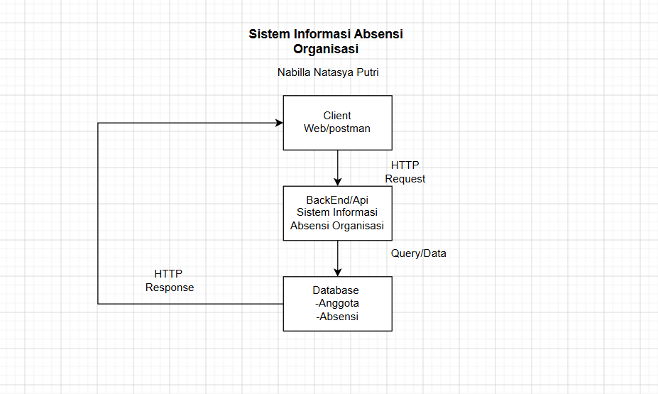

# Tugas 1 — Analisis dan Desain API

**Nama:** Nabilla Natasya Putri
**NPM:** 240160221029

---

## 1. Deskripsi Sistem

### Versi parafrase

Sistem Informasi Absensi Organisasi adalah sebuah sistem yang dibuat untuk memudahkan pengurus dalam mengelola informasi anggota serta mencatat kehadiran pada setiap kegiatan organisasi melalui API. Sistem ini menyediakan berbagai fungsi, seperti melihat, menambahkan, memperbarui, dan menghapus data anggota, sekaligus mengelola data absensi. Informasi anggota meliputi ID, nama, NIM, dan jabatan, sedangkan data absensi terdiri dari ID, ID anggota, nama kegiatan, tanggal, serta status kehadiran. Perancangan API ini bertujuan untuk menunjukkan proses komunikasi antara client dan backend menggunakan protokol HTTP dalam pengelolaan data anggota dan absensi organisasi.
---

## 2. Diagram Arsitektur API

Diagram arsitektur menggambarkan alur komunikasi antara client, backend API, dan database pada Sistem Informasi  Absensi Organisasi.



### Alur Komunikasi

1. Client mengirimkan HTTP Request kepada Backend API.
2. Backend API menerima dan memproses request dari client.
3. Backend API melakukan query atau pengolahan data pada database.
4. Database menyimpan dan menyediakan data anggota serta data absensi.
5. Backend API menerima data dari database.
6. Backend API mengirimkan HTTP Response kembali kepada client.

### Komponen Sistem

| Komponen | Fungsi |
|---|---|
| Client | Mengirim request dan menerima response dari API. Contohnya Web atau Postman. |
| Backend API | Memproses request dari client dan mengelola komunikasi dengan database. |
| Database | Menyimpan data anggota dan absensi setiap kegiatan. |
| HTTP Request | Permintaan yang dikirim client kepada backend API. |
| HTTP Response | Respons yang dikirim backend API kepada client. |

## 3. Resource dan Endpoint

Sistem menggunakan dua resource utama, yaitu **Anggota** dan **Absensi**.

### 3.1 Resource Anggota

Resource Anggota digunakan untuk mengelola data anggota organisasi.

| No | Operasi | Method | Endpoint | Request Body | Response Body | Sukses | Gagal |
|---:|---|---|---|---|---|---:|---:|
| 1 | Daftar anggota | GET | `/anggota` | - | Daftar anggota | 200 | 500 |
| 2 | Detail anggota | GET | `/anggota/:id` | - | Detail anggota | 200 | 404 |
| 3 | Tambah anggota | POST | `/anggota` | Data anggota| Data anggota | 201 | 400 |
| 4 | Ubah Anggota | PUT | `/anggota/:id` | Data anggota | Data anggota | 200 | 400 / 404 |
| 5 | Hapus Anggota | DELETE | `/anggota/:id` | - | - | 204 | 404 |

### 3.2 Resource Absensi

Resource Absensi digunakan untuk mengelola data kehadiran anggota dalam kegiatan organisasi.
| No | Operasi | Method | Endpoint | Request Body | Response Body | Sukses | Gagal |
|---:|---|---|---|---|---|---:|---:|
| 6 | Daftar Absensi| GET | `/absensi` | - | Daftar absensi | 200 | 500 |
| 7 | Detail Absensi | GET | `/absensi/:id` | - | Detail absensi | 200 | 404 |
| 8 | Tambah Absensi | POST | `/absensi` | Data absensi | Data absensi | 201 | 400 |
| 9 | Ubah Absensi | PUT | `/absensi/:id` | Data absensi | Data absensi | 200 | 400/404 |
| 10| Hapus Absensi | DELETE | `/absensi/:id` | - | - | 204 | 404 |

**Total endpoint: 10**

---

## 4. Struktur Data dan Contoh JSON

### 4.1 Resource Anggota

Data anggota terdiri dari:

- `id`
- `nama`
- `nim`
- `jabatan`

#### Contoh Request Body

Digunakan pada `POST /anggota`:

```json
{ 
  "nama": "Ende", 
  "nim": "260160221018", 
  "jabatan": " Ketua" }
```

#### Contoh Response Body

```json
{
  "success": true,
   "message": "Anggota berhasil ditambahkan", 
   "data": { 
    "id": "ABS001", 
    "nama": "Ende", 
    "nim": "260160221018", 
    "jabatan": "Ketua" }
}
```

### 4.2 Resource Absensi

Data anggota terdiri dari:

- `id`
- `anggota_id`
- `kegiatan`
- `tanggal`
- `status`

#### Contoh Request Body

Digunakan pada `POST /absensi`:

```json
{
  "anggota_id": "AGT001", 
  "kegiatan": "Rapat UKM", 
  "tanggal": "2026-08-18", 
  "status": "hadir"
}
```

#### Contoh Response Body

```json
{
  "success": true, 
  "message": "Absensi berhasil dicatat", 
  "data": { 
    "id": 1, 
    "anggota_id": "AGT001", 
    "kegiatan": "Rapat UKM", 
    "tanggal": "2026-08-18", 
    "status": "hadir"
  }
}
```

---

## 5. HTTP Status Code

Status code digunakan untuk menunjukkan hasil dari request yang dikirimkan oleh client.

| Status Code | Keterangan | Penggunaan |
|---:|---|---|
| 200 OK | Request berhasil diproses | GET dan PUT berhasil |
| 201 Created | Resource baru berhasil dibuat | POST berhasil |
| 204 No Content | Request berhasil dan tidak mengembalikan isi response | DELETE berhasil |
| 400 Bad Request | Request atau data yang dikirim tidak valid | POST atau PUT gagal karena data tidak valid |
| 404 Not Found | Resource yang diminta tidak ditemukan | GET, PUT, atau DELETE dengan ID yang tidak tersedia |
| 500 Internal Server Error | Terjadi kesalahan pada server | GET daftar data ketika terjadi masalah pada server |

---

## 6. Skenario Pengujian

### Skenario 1 — Mengambil Daftar Anggota

**Request:**

```http
GET /anggota
```

**Hasil yang diharapkan:**

```text
Status Code: 200 OK
```

Server mengembalikan daftar anggota yang tersedia.

Contoh response:

```json
{
  "success": true, 
  "total": 2, "data": [ 
    { "id": "ABS001", 
    "nama": "Ende", 
    "nim": "260160221018", 
    "jabatan": " Ketua" }, 

    { "id": "ABS002", 
    "nama": "Pingkan", 
    "nim": "260160221015", 
    "jabatan": "Wakil ketua"},
    
  ]
}
```

---

### Skenario 2 — Mencatat Absensi

**Request:**

```http
POST /absensi
```

**Request Body:**

```json
{
  "anggota_id": "AGT001", 
  "kegiatan": "Rapat UKM", 
  "tanggal": "2026-08-18", 
  "status": "hadir"
}
```

**Hasil yang diharapkan:**

```text
Status Code: 201 Created
```

Server berhasil membuat data absensi baru dan mengembalikan data tersebut.

Contoh response:

```json
{
  "success": true, 
  "message": "Absensi berhasil dicatat", 
  "data": { 
    "id": 1, 
    "anggota_id": "AGT001", 
    "kegiatan": "Rapat UKM", 
    "tanggal": "2026-08-18", 
    "status": "hadir"
  }
}
```

---

### Skenario 3 — Mengakses Anggota yang Tidak Ditemukan

**Request:**

```http
GET /anggota/999
```

Diasumsikan buku dengan ID `999` tidak tersedia.

**Hasil yang diharapkan:**

```text
Status Code: 404 Not Found
```

Contoh response:

```json
{
  "success": false,
  "message": "Anggota tidak ditemukan"
}
```

Skenario ini merupakan contoh pengujian gagal untuk memastikan API dapat memberikan respons yang sesuai ketika resource yang diminta tidak ditemukan.

---

## 7. Kesimpulan

Perancangan API Sistem Informasi Absensi Organisasi terdiri dari dua resource utama, yaitu Anggota dan Absensi, dengan total sepuluh endpoint. Endpoint dirancang menggunakan metode HTTP seperti GET, POST, PUT, dan DELETE sesuai dengan fungsi masing-masing operasi.

Perancangan juga mencakup struktur request dan response JSON, HTTP status code, serta skenario pengujian berhasil dan gagal. Dengan rancangan ini, komunikasi antara client, backend API, dan database dapat digambarkan secara terstruktur sebelum API diimplementasikan ke dalam program.