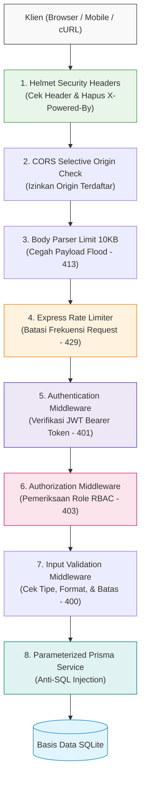

# AKTIFITAS KELOMPOK — PERTEMUAN 11

## SECURITY CHECKLIST & KEAMANAN BACKEND API

---

### IDENTITAS KELOMPOK

- **Kelompok:** 3 (Tiga)
- **Kelas:** SI-VA
- **Mata Kuliah:** Pemrograman Backend Web Framework
- **Studi Kasus:** Sistem Informasi Akademik / Manajemen Data Mahasiswa
- **Anggota Kelompok:**
  - Devaldy Zikri S
  - Eka Bareeq Ibrahim
  - Faishal Rizky Fadhilah
  - Fauzan Zainul Arifin

---

## 1. PENDAHULUAN & PRINSIP DEFENSE-IN-DEPTH

Pada Pertemuan 9 dan 10, Sistem Informasi Akademik telah mengintegrasikan modul autentikasi dan otorisasi berbasis JWT. Namun, dalam ekosistem web modern, otentikasi identitas saja tidak cukup untuk menangkal berbagai vektor serangan siber seperti _Denial of Service (DoS)_, _Cross-Origin Abuse_, _SQL Injection_, manipulasi ukuran payload, dan _Information Disclosure_.

Kelompok 3 merumuskan **Security Checklist** berbasis pendekatan _Defense-in-Depth_ (pertahanan berlapis) untuk memastikan bahwa API akademik tidak hanya membatasi hak akses, tetapi juga tangguh menghadapi input berbahaya, pembajakan browser, dan eksploitasi infrastruktur.

---

## 2. SECURITY CHECKLIST DOMAIN SISTEM INFORMASI AKADEMIK

Berikut adalah matriks checklist keamanan backend yang dirancang dan diterapkan pada API Sistem Informasi Akademik:

| No  | Komponen Keamanan                       | Risiko yang Dicegah                                                                                          | Konfigurasi / Kebijakan yang Diterapkan                                                                                       | Perintah `curl` Pembuktian Penolakan / Verifikasi                                                                                                                                          | Respon yang Diharapkan                                                                                              |
| :-: | :-------------------------------------- | :----------------------------------------------------------------------------------------------------------- | :---------------------------------------------------------------------------------------------------------------------------- | :----------------------------------------------------------------------------------------------------------------------------------------------------------------------------------------- | :------------------------------------------------------------------------------------------------------------------ |
|  1  | **Security Headers (`helmet`)**         | _Clickjacking_, _MIME-sniffing_, _XSS Reflected_, dan kebocoran versi server (_Information Disclosure_).     | Pasang `helmet()` pada baris middleware teratas Express, matikan header `X-Powered-By`.                                       | `curl -I http://localhost:3011/health`                                                                                                                                                     | Header `X-Content-Type-Options: nosniff`, `X-Frame-Options: SAMEORIGIN` muncul, `X-Powered-By` tidak ada.           |
|  2  | **CORS Selektif (_Whitelist_)**         | _Cross-Origin Abuse_ di mana website pihak ketiga yang berbahaya memanggil API akademik dari browser korban. | Membatasi `origin` hanya untuk domain frontend resmi (`http://localhost:3000`, `http://127.0.0.1:3000`).                      | `curl -I -H "Origin: http://malicious-site.com" http://localhost:3011/api/mahasiswa`                                                                                                       | Header `Access-Control-Allow-Origin` **tidak dikirim** oleh server untuk origin penyerang.                          |
|  3  | **Rate Limiting Login**                 | Serangan _Brute Force_ dan _Credential Stuffing_ pada endpoint autentikasi akun akademik.                    | `express-rate-limit` diset maksimal 5 request per 15 menit per alamat IP untuk rute `/auth/login`.                            | Eksekusi loop 6x: `curl -X POST http://localhost:3011/auth/login -H "Content-Type: application/json" -d '{"email":"test@test.id","password":"wrong"}'`                                     | Request ke-6 menghasilkan status HTTP `429 Too Many Requests`.                                                      |
|  4  | **Rate Limiting Global API**            | _Resource Exhaustion_ dan _Denial of Service (DoS)_ pada endpoint publik / baca data.                        | Maksimal 100 request per 15 menit per alamat IP untuk rute umum.                                                              | Eksekusi request melebihi ambang batas window.                                                                                                                                             | Status HTTP `429 Too Many Requests` disertai header `Retry-After`.                                                  |
|  5  | **Pembatasan Ukuran Body**              | Serangan kehabisan memori server (_Memory Flooding / Buffer Exhaustion_) melalui pengiriman JSON raksasa.    | Pasang `express.json({ limit: "10kb" })` pada parser body Express.                                                            | `curl -X POST http://localhost:3011/api/mahasiswa -H "Content-Type: application/json" -d '{"bigData":"'$(python -c "print('A'*20000)")'"}'`                                                | Status HTTP `413 Payload Too Large`.                                                                                |
|  6  | **Validasi & Sanitasi Input**           | Injeksi karakter berbahaya, tipe data salah, atau _boundary error_ pada data mahasiswa.                      | Validasi ketat tipe data, regex angka NIM (8–20 digit), batas panjang nama (2–100 karakter), dan tahun angkatan.              | `curl -X POST http://localhost:3011/api/mahasiswa -H "Content-Type: application/json" -H "Authorization: Bearer <TOKEN>" -d '{"nim":"123","nama":"A","prodi":"","angkatan":"bukanAngka"}'` | Status HTTP `400 Bad Request` dengan rincian pesan error validasi yang jelas.                                       |
|  7  | **Query Terparameterisasi (Anti-SQLi)** | _SQL Injection_ yang memanipulasi struktur query SQL melalui parameter pencarian atau body.                  | Seluruh interaksi database wajib menggunakan Prisma ORM parameter query API, dilarang merangkai string SQL mentah.            | `curl -X GET "http://localhost:3011/api/mahasiswa?search=' OR '1'='1"`                                                                                                                     | Status `200 OK`, namun payload `' OR '1'='1` dianggap sebagai teks string pencarian harfiah.                        |
|  8  | **Centralized Safe Error Handler**      | Kebocoran detail internal database, path direktori server, dan stack trace error (_Error Disclosure_).       | Middleware error terpusat menangkap seluruh exception dan hanya mengirim pesan generik ramah pengguna ke client.              | `curl -X POST http://localhost:3011/api/mahasiswa -H "Content-Type: application/json" -d 'invalid-json{'`                                                                                  | Status HTTP `400 Bad Request` `{ "success": false, "message": "Format JSON tidak valid" }` tanpa bocor stack trace. |
|  9  | **Secret Management**                   | Kunci JWT dan credential database bocor ke GitHub repository publik.                                         | Simpan seluruh nilai rahasia di `.env`, daftarkan `.env` dan `*.db` pada `.gitignore`, sediakan template aman `.env.example`. | `git status --ignored` atau memeriksa file yang di-commit pada branch.                                                                                                                     | File `.env` dan `.db` tidak pernah berstatus _tracked_ atau _staged_ oleh Git.                                      |

---

## 3. ANALISIS PERTANYAAN DISKUSI KELOMPOK

### A. Mengapa `helmet` Tidak Mencegah SQL Injection?

`helmet` adalah middleware Express yang bekerja khusus pada lapisan **Header HTTP Respons** browser (seperti memasang `Content-Security-Policy`, `X-Frame-Options`, `X-Content-Type-Options`).

Tugas `helmet` adalah memberikan instruksi keamanan kepada **Browser Klien** agar browser tidak mengeksekusi skrip berbahaya atau memuat konten dari sumber yang tidak sah. Sebaliknya, SQL Injection adalah kerentanan pada lapisan **Akses Basis Data di Server Backend**. Masukan SQL Injection dikirim melalui body atau query parameter request, langsung diproses oleh server, dan dieksekusi oleh mesin basis data. Karena `helmet` tidak memeriksa maupun memodifikasi masukan yang dikirim ke database, `helmet` sama sekali tidak memiliki kemampuan mencegah SQL Injection.

### B. Mengapa CORS Bukan Mekanisme Keamanan API?

_Cross-Origin Resource Sharing_ (CORS) adalah mekanisme pengaman yang ditegakkan secara sukarela oleh **Browser Web**, bukan oleh backend server:

1. CORS dirancang untuk melindungi **pengguna browser** dari script website asing yang mencoba mencuri data dari website lain menggunakan kredensial cookie/session browser korban.
2. Penyerang, bot, script Python, Postman, atau perintah `curl` dari terminal **sama sekali tidak mematuhi aturan CORS**. Mereka dapat memanggil API tanpa browser dan mengabaikan header CORS sepenuhnya.
3. Oleh sebab itu, CORS tidak boleh dianggap sebagai pelindung API dari akses liar; keamanan API sesungguhnya wajib ditegakkan melalui autentikasi (JWT), otorisasi (RBAC), validasi input, dan rate limiting di sisi server.

---

## 4. DIAGRAM ARSITEKTUR PERTAHANAN BERLAPIS (MERMAID)

---

## 5. KESIMPULAN

Penerapan Security Checklist pada Sistem Informasi Akademik melengkapi arsitektur backend menjadi standar _production-ready_. Dengan mengkombinasikan proteksi browser (_security headers_), proteksi ketersediaan (_rate limiting_ & _body limit_), proteksi identitas (_JWT & RBAC_), dan proteksi integritas data (_input validation_ & _parameterized queries_), sistem kebal terhadap ancaman umum siber tanpa mengorbankan fungsionalitas utama manajemen data mahasiswa.
