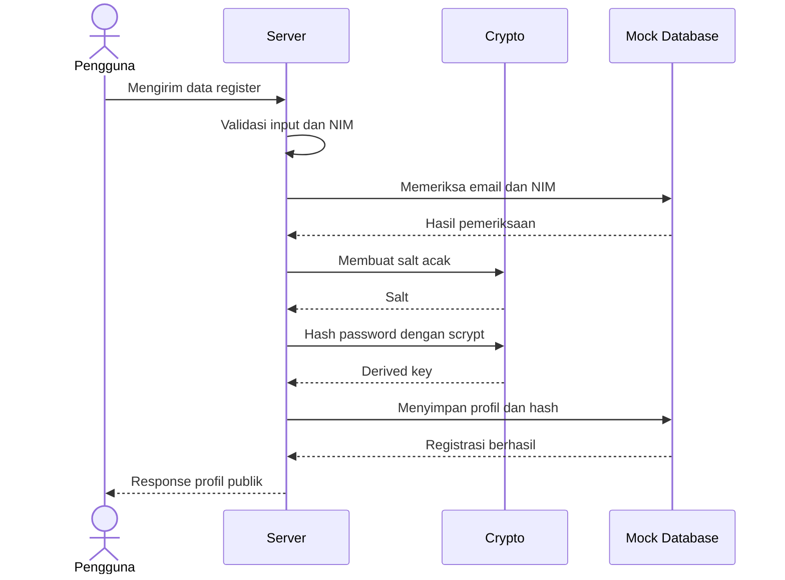
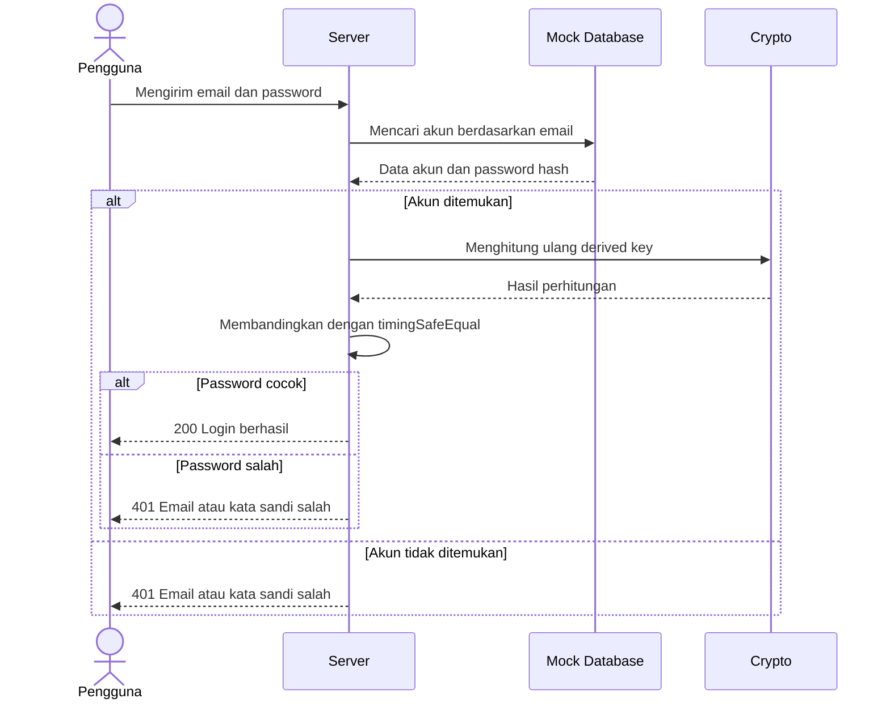

# Latihan Individu Pertemuan 9

## Authentication dan Perlindungan Kredensial Pengguna

### Identitas Mahasiswa

- Nama: Devaldy Dzikri S
- NIM: 240160221050

### Deskripsi

Latihan ini membahas penerapan authentication dan perlindungan kredensial pengguna. Program dibuat menggunakan TypeScript dan modul crypto dari Node.js.

Implementasi mencakup validasi NIM sebagai identitas unik kedua, hashing password menggunakan algoritma scrypt, serta verifikasi password menggunakan timingSafeEqual.

Program menggunakan mock database berupa array untuk mensimulasikan proses register dan login tanpa koneksi database eksternal.

### Teknologi yang Digunakan

- Node.js
- TypeScript
- Node.js Crypto
- Scrypt
- TimingSafeEqual

### Struktur File

```text
latihan-individu/
├── latihan9.ts
├── test-latihan9.ts
└── readme.md
```

### Fitur Implementasi

1. Validasi NIM dengan panjang 8–20 digit angka.
2. Pemeriksaan tipe data NIM.
3. Hashing password menggunakan scrypt.
4. Pembuatan salt acak untuk setiap password.
5. Verifikasi password menggunakan timingSafeEqual.
6. Simulasi register dan login.
7. Pencegahan email dan NIM duplikat.
8. Response login tanpa password maupun password hash.

### Cara Menjalankan

Pastikan Node.js sudah terpasang.

Jalankan pengujian menggunakan perintah:

```bash
npx tsx test-latihan9.ts
```

Jika TypeScript dan tsx belum tersedia pada project, jalankan:

```bash
npm install -D typescript tsx @types/node
```

### Skenario Pengujian

| No. | Skenario                        | Hasil yang Diharapkan |
| --- | ------------------------------- | --------------------- |
| 1   | NIM valid 12 digit              | PASS                  |
| 2   | NIM mengandung huruf            | PASS                  |
| 3   | NIM kurang dari 8 digit         | PASS                  |
| 4   | NIM bertipe number              | PASS                  |
| 5   | NIM mengandung spasi            | PASS                  |
| 6   | Register data valid             | PASS                  |
| 7   | NIM duplikat                    | PASS                  |
| 8   | Email duplikat                  | PASS                  |
| 9   | NIM tidak valid                 | PASS                  |
| 10  | Tipe NIM keliru                 | PASS                  |
| 11  | Login berhasil                  | PASS                  |
| 12  | Password salah                  | PASS                  |
| 13  | Email tidak terdaftar           | PASS                  |
| 14  | Tipe email keliru               | PASS                  |
| 15  | Tipe password keliru            | PASS                  |
| 16  | Response tidak membocorkan hash | PASS                  |
| 17  | Password berhasil diproses      | PASS                  |

### Penjelasan Keamanan Password

Password tidak disimpan dalam bentuk teks biasa, melainkan diubah menjadi hash menggunakan algoritma scrypt dengan salt acak.

Salt berfungsi agar password yang sama dapat menghasilkan hash yang berbeda. Saat login, sistem menghitung ulang derived key berdasarkan password yang dimasukkan dan salt yang tersimpan.

Hasil perhitungan dibandingkan menggunakan timingSafeEqual untuk mengurangi risiko timing attack.

Password hash tidak boleh dikirimkan dalam response karena dapat dimanfaatkan pihak lain untuk melakukan percobaan menebak password secara offline. Oleh karena itu, response hanya mengembalikan informasi publik seperti ID, nama, NIM, dan email.

### Sequence Diagram Register



### Sequence Diagram Login



### Kesimpulan

Berdasarkan latihan yang dilakukan, authentication membutuhkan pengelolaan kredensial yang aman agar informasi pengguna tidak mudah disalahgunakan. Penambahan NIM sebagai identitas unik kedua membantu mencegah penggunaan identitas mahasiswa yang sama. Penggunaan scrypt, salt acak, dan timingSafeEqual membantu melindungi password selama proses register dan login.

Program ini masih menggunakan mock database sehingga data hanya tersimpan selama aplikasi berjalan dan belum ditujukan untuk penggunaan production.
