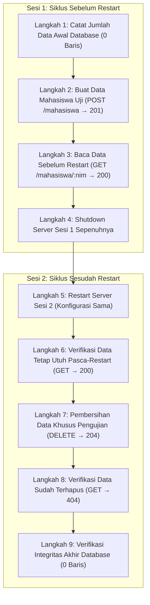

# Laporan Pengujian API Mahasiswa — Latihan Individu Pertemuan 8

Dokumentasi pengujian otomatis (*automated integration & persistence testing*) untuk memverifikasi fungsionalitas, validasi input, kepatuhan kode status HTTP, dan persistensi basis data pada REST API Mahasiswa.

---

## 1. Identitas Tugas

* **Mata Kuliah:** Pengembangan Aplikasi Web Backend (SI-VA-Backend)
* **Pertemuan:** Pertemuan 8 — Pengujian REST API dan Persistensi Basis Data
* **Tugas:** Latihan Individu Pertemuan 8
* **Nama Mahasiswa:** Aldi Restu Fauzi
* **NIM:** 240160221001
* **Direktori Tugas:** `Aldi_240160221001/Pertemuan-8/Latihan-Individu/`

---

## 2. Tujuan Pengujian

Tujuan dari pengujian pada Latihan Individu Pertemuan 8 adalah:
1. Memverifikasi seluruh endpoint utama API Mahasiswa bekerja sesuai spesifikasi standar RESTful API (kode status 200, 201, 204, dan 404).
2. Menguji ketahanan gerbang validasi input (pengujian negatif) terhadap field kosong, kesalahan tipe data, nilai di luar rentang, dan payload kosong dengan memastikan status HTTP 400 Bad Request dikembalikan dengan pesan yang tepat.
3. Menguji persistensi basis data fisik SQLite (`prisma/dev.db`) untuk membuktikan bahwa data yang dibuat melalui endpoint POST tetap tersimpan dan dapat diakses kembali setelah server Express dimatikan sepenuhnya dan di-restart.
4. Memastikan integritas basis data tetap bersih tanpa meninggalkan artefak data sementara uji.

---

## 3. Objek Pengujian dan Lokasi Proyek

> [!IMPORTANT]
> **API yang diuji adalah REST API Mahasiswa yang telah dibangun pada Tugas 5 Pertemuan 7, BUKAN API baru.**

* **Lokasi Objek Pengujian:**  
  `Aldi_240160221001/Pertemuan-7/Tugas-5/`
* **Arsitektur API Objek Uji:**  
  Arsitektur berlapis (*Layered Architecture*) yang memisahkan tanggung jawab secara ketat:
  * `app.ts` & `server.ts`: Inisialisasi Express, middleware parsing JSON, routing utama, dan penanganan error global.
  * `src/routes/mahasiswa.routes.ts`: Lapisan routing HTTP Express.
  * `src/controller/mahasiswa.controller.ts`: Lapisan validasi tipe data gerbang `typeof`, validasi domain data, dan penyusunan respon HTTP.
  * `src/service/mahasiswa.service.ts`: Lapisan logika bisnis murni dan manipulasi data melalui Prisma ORM.
  * `src/config/client.ts`: Singleton instance PrismaClient dengan driver `@prisma/adapter-better-sqlite3`.
* **File Basis Data Fisik:**  
  `Aldi_240160221001/Pertemuan-7/Tugas-5/prisma/dev.db`

---

## 4. Teknologi yang Digunakan

Spesifikasi teknologi diverifikasi langsung terhadap `package.json` dan `package-lock.json` pada proyek Tugas 5:

| Komponen | Paket / Teknologi | Versi Deklarasi (`package.json`) | Versi Terpasang (`package-lock.json`) | Peran dalam Proyek & Pengujian |
|---|---|:---:|:---:|---|
| Runtime | Node.js | `v26.9.0` | `v26.9.0` | Menjalankan server dan skrip pengujian via native TypeScript execution (`--experimental-strip-types`) |
| Web Framework | `express` | `^5.3.0` | `5.3.0` | Framework server HTTP dan routing API objek uji |
| ORM Client | `@prisma/client` | `^7.10.1` | `7.10.1` | Object-Relational Mapping untuk kueri data |
| Database Adapter | `@prisma/adapter-better-sqlite3` | `^7.10.1` | `7.10.1` | Driver adapter SQLite resmi untuk Prisma v7 |
| Database Engine | `better-sqlite3` | `^13.0.3` | `13.0.3` | Driver SQLite berkinerja tinggi |
| Konfigurasi Env | `dotenv` | `^18.0.9` | `18.0.9` | Pemuat variabel lingkungan database dan port |
| Bahasa Pemrograman | `typescript` | `^7.0.2` | `7.0.2` | Compiler dan pemeriksaan tipe statis |
| Type Definitions | `@types/express` | `^5.0.6` | `5.0.6` | Definisi tipe statis Express |
| Type Definitions | `@types/node` | `^26.6.2` | `26.6.6` | Definisi tipe statis Node.js |
| CLI Perkakas | `prisma` | `^7.10.1` | `7.10.1` | Prisma CLI untuk migrasi dan generate client |
| HTTP Client Uji | Native Fetch API | Bawaan Node.js | Bawaan Node.js | Mengirim HTTP request otomatis ke endpoint uji |

---

## 5. Daftar Skenario Pengujian Endpoint dan Validasi Negatif

Pengujian fungsional dan pengujian negatif diimplementasikan pada skrip [`test-latihan-8.ts`](test-latihan-8.ts) dengan mencakup 25 skenario uji:

### Aturan Validasi Aktual Lapisan Controller (`mahasiswa.controller.ts`)
Berdasarkan implementasi kode pada Controller Tugas 5, validasi field `angkatan` diatur secara ketat:
* **Tipe Data:** Wajib bilangan primitif (`typeof angkatan === "number"`). Tipe string angka (misal `"2024"`) ditolak.
* **Format:** Wajib bilangan bulat (`Number.isInteger(angkatan)`). Nilai pecahan/desimal (misal `2024.5`) ditolak.
* **Batas Rentang Nilai:**
  * **Batas Minimum:** `2000` (nilai `< 2000` ditolak dengan status HTTP 400).
  * **Batas Maksimum:** `currentYear` dinamis dari sistem (`new Date().getFullYear()`, saat ini bernilai `2026`). Nilai `> 2026` ditolak dengan status HTTP 400.
* **Pesan Kesalahan:** `"Field 'angkatan' wajib berupa angka bilangan bulat antara 2000 dan 2026"`.

### A. Pengujian Endpoint Utama
1. **GET `/api/health`** — Pemeriksaan kesehatan koneksi API dan basis data (Status 200 OK).
2. **GET `/mahasiswa`** — Mengambil seluruh daftar data mahasiswa pada kondisi awal (Status 200 OK).
3. **POST `/mahasiswa`** — Menambahkan record mahasiswa baru dengan payload data valid menggunakan NIM khusus `TEST80000001` (Status 201 Created).
4. **GET `/mahasiswa/:nim`** — Mengambil detail data mahasiswa yang baru dibuat (Status 200 OK).
5. **GET `/mahasiswa/:nim`** — Mengambil detail mahasiswa dengan NIM yang tidak terdaftar (Status 404 Not Found).
6. **PATCH `/mahasiswa/:nim`** — Memperbarui sebagian field mahasiswa secara valid (Status 200 OK).
7. **DELETE `/mahasiswa/:nim`** — Menghapus data mahasiswa uji (Status 204 No Content tanpa body).
8. **GET `/mahasiswa/:nim`** — Memastikan data uji telah terhapus dari basis data (Status 404 Not Found).

### B. Pengujian Negatif POST `/mahasiswa` (Status 400 Bad Request)
9. **Field `nim` tidak disertakan** pada payload body.
10. **Field `nama` bernilai string kosong** atau hanya berisi karakter spasi.
11. **Field `prodi` tidak disertakan** pada payload body.
12. **Tipe data `angkatan` salah**, dikirim berupa string angka (`"2024"` alih-alih number integer).
13. **Nilai `angkatan` bukan bilangan bulat**, dikirim berupa angka desimal/pecahan (`2024.5`).
14. **Nilai `angkatan` di bawah batas minimum (1999)**, ditolak karena nilai `< 2000`.
15. **Nilai `angkatan` di atas batas maksimum tahun berjalan (2030)**, ditolak karena nilai `> 2026`.

### C. Pengujian Negatif PATCH `/mahasiswa/:nim` (Status 400 Bad Request)
16. **Payload body kosong `{}`**, tidak ada satu pun field yang dikirim untuk diperbarui.
17. **Mencoba memodifikasi field `nim`**, melanggar aturan integritas pengenal unik.
18. **Field `nama` bernilai string kosong** atau hanya spasi pada update.
19. **Field `prodi` bernilai string kosong** atau hanya spasi pada update.
20. **Tipe data `angkatan` berupa string** pada update.
21. **Nilai `angkatan` desimal/pecahan** pada update (`2024.75`).
22. **Nilai `angkatan` di bawah batas minimum (1995)**, ditolak karena nilai `< 2000`.
23. **Nilai `angkatan` di atas batas maksimum tahun berjalan (2035)**, ditolak karena nilai `> 2026`.

### D. Pembersihan dan Verifikasi Integritas
24. **DELETE `/mahasiswa/:nim`** — Pembersihan data uji sementara untuk skenario PATCH (Status 204 No Content).
25. **Verifikasi Integritas Database** — Memastikan jumlah baris akhir sama persis dengan kondisi awal (0 baris).

---

## 6. Hasil Pengujian Fungsional (25/25 PASS)

Eksekusi skrip `test-latihan-8.ts` menghasilkan tingkat keberhasilan **100% (25 LULUS, 0 GAGAL)**:

| No | Skenario Pengujian | Endpoint / Target | Status Diharapkan | Status Aktual | Hasil |
|:---:|---|---|:---:|:---:|:---:|
| 1 | Pemeriksaan kesehatan API dan koneksi database | `GET /api/health` | 200 | 200 | **PASS** |
| 2 | Mengambil seluruh daftar mahasiswa (kondisi awal) | `GET /mahasiswa` | 200 | 200 | **PASS** |
| 3 | Membuat data mahasiswa baru dengan payload valid | `POST /mahasiswa` | 201 | 201 | **PASS** |
| 4 | Mengambil detail mahasiswa yang baru dibuat | `GET /mahasiswa/TEST80000001` | 200 | 200 | **PASS** |
| 5 | Mengambil detail mahasiswa dengan NIM tidak terdaftar | `GET /mahasiswa/NIM_TIDAK_ADA_9999` | 404 | 404 | **PASS** |
| 6 | Memperbarui sebagian data mahasiswa secara valid | `PATCH /mahasiswa/TEST80000001` | 200 | 200 | **PASS** |
| 7 | Menghapus data mahasiswa uji | `DELETE /mahasiswa/TEST80000001` | 204 | 204 | **PASS** |
| 8 | Verifikasi data uji telah terhapus dari basis data | `GET /mahasiswa/TEST80000001` | 404 | 404 | **PASS** |
| 9 | POST: Field `nim` tidak disertakan | `POST /mahasiswa` | 400 | 400 | **PASS** |
| 10 | POST: Field `nama` berupa spasi kosong | `POST /mahasiswa` | 400 | 400 | **PASS** |
| 11 | POST: Field `prodi` tidak disertakan | `POST /mahasiswa` | 400 | 400 | **PASS** |
| 12 | POST: Tipe data `angkatan` berupa string (`"2024"`) | `POST /mahasiswa` | 400 | 400 | **PASS** |
| 13 | POST: `angkatan` bernilai desimal (`2024.5`) | `POST /mahasiswa` | 400 | 400 | **PASS** |
| 14 | POST: `angkatan` di bawah batas minimum (`1999` < 2000) | `POST /mahasiswa` | 400 | 400 | **PASS** |
| 15 | POST: `angkatan` di atas batas maksimum (`2030` > 2026) | `POST /mahasiswa` | 400 | 400 | **PASS** |
| 16 | PATCH: Payload body kosong `{}` | `PATCH /mahasiswa/TEST80000002` | 400 | 400 | **PASS** |
| 17 | PATCH: Mencoba memodifikasi field `nim` | `PATCH /mahasiswa/TEST80000002` | 400 | 400 | **PASS** |
| 18 | PATCH: Field `nama` berupa spasi kosong | `PATCH /mahasiswa/TEST80000002` | 400 | 400 | **PASS** |
| 19 | PATCH: Field `prodi` berupa spasi kosong | `PATCH /mahasiswa/TEST80000002` | 400 | 400 | **PASS** |
| 20 | PATCH: Tipe data `angkatan` berupa string (`"2024"`) | `PATCH /mahasiswa/TEST80000002` | 400 | 400 | **PASS** |
| 21 | PATCH: `angkatan` bernilai desimal (`2024.75`) | `PATCH /mahasiswa/TEST80000002` | 400 | 400 | **PASS** |
| 22 | PATCH: `angkatan` di bawah batas minimum (`1995` < 2000) | `PATCH /mahasiswa/TEST80000002` | 400 | 400 | **PASS** |
| 23 | PATCH: `angkatan` di atas batas maksimum (`2035` > 2026) | `PATCH /mahasiswa/TEST80000002` | 400 | 400 | **PASS** |
| 24 | Pembersihan data sementara uji PATCH | `DELETE /mahasiswa/TEST80000002` | 204 | 204 | **PASS** |
| 25 | Verifikasi integritas database (kembali ke awal) | `Database State Check` | 0 baris | 0 baris | **PASS** |

---

## 7. Prosedur Pengujian Persistensi Setelah Server Restart

Pengujian persistensi pada skrip [`test-persistence.ts`](test-persistence.ts) memvalidasi penyimpanan fisik ke disk basis data SQLite melewati siklus hidup server secara penuh yang terbagi ke dalam **9 tahapan pengujian**:



### Tabel Rincian 9 Langkah Pengujian Persistensi:

| Langkah | Fase Pengujian | Aksi & Endpoint | Verifikasi yang Diharapkan |
|:---:|---|---|---|
| **1** | Persiapan | `prisma.mahasiswa.count()` | Mencatat jumlah baris awal pada database (kondisi bersih = 0 baris). |
| **2** | Sesi 1 | `POST /mahasiswa` | Membuat record baru dengan NIM `TEST80000003` pada server sesi 1 (Status HTTP 201 Created). |
| **3** | Sesi 1 | `GET /mahasiswa/TEST80000003` | Membaca record dari server sesi 1 untuk memastikan data berhasil tersimpan (Status HTTP 200 OK). |
| **4** | Transisi | `server1.close()` | Mematikan server instance sesi 1 secara penuh (*graceful shutdown*) dan port dilepaskan. |
| **5** | Sesi 2 | `app.listen(0)` | Menjalankan server instance sesi 2 dengan konfigurasi database yang sama. |
| **6** | Sesi 2 | `GET /mahasiswa/TEST80000003` | Membaca data yang dibuat pada sesi 1 melalui server sesi 2. Data harus tetap utuh (Status HTTP 200 OK). |
| **7** | Pembersihan | `DELETE /mahasiswa/TEST80000003` | Menghapus record pengujian agar basis data kembali bersih (Status HTTP 204 No Content). |
| **8** | Validasi | `GET /mahasiswa/TEST80000003` | Memastikan data benar-benar telah terhapus dari database (Status HTTP 404 Not Found). |
| **9** | Penutupan | `prisma.mahasiswa.count()` | Menghitung baris akhir database dan memastikan jumlahnya sama persis dengan langkah 1 (0 baris). |

---

## 8. Hasil Pengujian Persistensi (9/9 PASS)

Eksekusi skrip `test-persistence.ts` membuktikan bahwa data tersimpan secara non-volatil ke dalam file `prisma/dev.db` dan lulus **100% (9 LULUS, 0 GAGAL)**:

| No | Tahap Pengujian | Status Diharapkan | Status Aktual | Hasil |
|:---:|---|:---:|:---:|:---:|
| 1 | Pencatatan data awal basis data | `0 baris` | `0 baris` | **PASS** |
| 2 | Pembuatan data mahasiswa uji (`POST /mahasiswa`) | `201 Created` | `201 Created` | **PASS** |
| 3 | Pembacaan data sebelum restart (`GET /mahasiswa/:nim`) | `200 OK` | `200 OK` | **PASS** |
| 4 | Shutdown server sesi 1 secara tuntas | *Closed* | *Closed* | **PASS** |
| 5 | Restart server sesi 2 dengan konfigurasi sama | *Listening* | *Listening* | **PASS** |
| 6 | Verifikasi data tetap ada pasca-restart (`GET /mahasiswa/:nim`) | `200 OK` | `200 OK` | **PASS** |
| 7 | Penghapusan data uji sementara (`DELETE /mahasiswa/:nim`) | `204 No Content` | `204 No Content` | **PASS** |
| 8 | Verifikasi data sudah tidak ada (`GET /mahasiswa/:nim`) | `404 Not Found` | `404 Not Found` | **PASS** |
| 9 | Verifikasi integritas jumlah baris database akhir | `0 baris` | `0 baris` | **PASS** |

### Bukti Data Terbaca Sebelum dan Sesudah Restart:
* **Sebelum Shutdown (Server Sesi 1):**
  ```json
  {
    "id": 9,
    "nim": "TEST80000003",
    "nama": "Mahasiswa Uji Persistensi",
    "prodi": "Sistem Informasi",
    "angkatan": 2024
  }
  ```
* **Setelah Restart (Server Sesi 2):**
  ```json
  {
    "id": 9,
    "nim": "TEST80000003",
    "nama": "Mahasiswa Uji Persistensi",
    "prodi": "Sistem Informasi",
    "angkatan": 2024
  }
  ```

---

## 9. Cara Menjalankan Skrip Pengujian

Seluruh perintah dirancang secara **portabel** menggunakan path relatif dinamis via `Resolve-Path` (PowerShell) atau `realpath` (Bash) dengan normalisasi *slash* (`/`) untuk protokol `file:` SQLite sehingga dapat dijalankan pada lingkungan komputer manapun tanpa bergantung pada nama drive (`C:`, `D:`) atau direktori pengguna tertentu.

### Langkah 1: Masuk ke Direktori Latihan Pertemuan 8
```powershell
cd Aldi_240160221001/Pertemuan-8/Latihan-Individu
```

### Langkah 2: Menjalankan Pengujian Fungsional dan Negatif (25 Skenario)

* **Pada Windows PowerShell:**
  ```powershell
  $env:NODE_PATH = (Resolve-Path "../../Pertemuan-7/Tugas-5/node_modules").Path
  $dbPath = (Resolve-Path "../../Pertemuan-7/Tugas-5/prisma/dev.db").Path -replace '\\', '/'
  $env:DATABASE_URL = "file:$dbPath"
  node --experimental-strip-types test-latihan-8.ts
  ```

* **Perintah Satu Baris (PowerShell):**
  ```powershell
  $env:NODE_PATH=(Resolve-Path "../../Pertemuan-7/Tugas-5/node_modules").Path; $dbPath=(Resolve-Path "../../Pertemuan-7/Tugas-5/prisma/dev.db").Path -replace '\\','/'; $env:DATABASE_URL="file:$dbPath"; node --experimental-strip-types test-latihan-8.ts
  ```

* **Pada Linux / macOS / Bash:**
  ```bash
  NODE_PATH="../../Pertemuan-7/Tugas-5/node_modules" DATABASE_URL="file:$(realpath ../../Pertemuan-7/Tugas-5/prisma/dev.db)" node --experimental-strip-types test-latihan-8.ts
  ```

### Langkah 3: Menjalankan Pengujian Persistensi dan Siklus Restart (9 Tahapan)

* **Pada Windows PowerShell:**
  ```powershell
  $env:NODE_PATH = (Resolve-Path "../../Pertemuan-7/Tugas-5/node_modules").Path
  $dbPath = (Resolve-Path "../../Pertemuan-7/Tugas-5/prisma/dev.db").Path -replace '\\', '/'
  $env:DATABASE_URL = "file:$dbPath"
  node --experimental-strip-types test-persistence.ts
  ```

* **Perintah Satu Baris (PowerShell):**
  ```powershell
  $env:NODE_PATH=(Resolve-Path "../../Pertemuan-7/Tugas-5/node_modules").Path; $dbPath=(Resolve-Path "../../Pertemuan-7/Tugas-5/prisma/dev.db").Path -replace '\\','/'; $env:DATABASE_URL="file:$dbPath"; node --experimental-strip-types test-persistence.ts
  ```

* **Pada Linux / macOS / Bash:**
  ```bash
  NODE_PATH="../../Pertemuan-7/Tugas-5/node_modules" DATABASE_URL="file:$(realpath ../../Pertemuan-7/Tugas-5/prisma/dev.db)" node --experimental-strip-types test-persistence.ts
  ```

---

## 10. Kesimpulan

Berdasarkan seluruh hasil pengujian yang telah dilaksanakan pada Latihan Individu Pertemuan 8:
1. **Kepatuhan Kontrak API:** REST API Mahasiswa pada Tugas 5 terbukti mematuhi standar perancangan RESTful API dengan kode status yang tepat (200 OK, 201 Created, 204 No Content, 400 Bad Request, 404 Not Found, dan 409 Conflict).
2. **Ketahanan Validasi Input:** Lapisan Controller berhasil menolak seluruh data cacat (field kosong, tipe data string pada angka, nilai di luar domain tahun 2000 s.d. tahun berjalan 2026, dan payload kosong) sebelum menyentuh lapisan database.
3. **Persistensi Terverifikasi:** Basis data SQLite terbukti bekerja secara persisten (*non-volatile storage*). Data berhasil disimpan ke piringan disk lokal (`prisma/dev.db`) dan tidak hilang saat server dimatikan secara total maupun di-restart.
4. **Kebersihan dan Integritas Basis Data:** Seluruh pengujian menggunakan identitas data khusus pengujian (`TEST80000001`, `TEST80000002`, `TEST80000003`) dan seluruhnya berhasil dibersihkan otomatis pada akhir pengujian, menjaga jumlah baris database tetap 0 baris.
