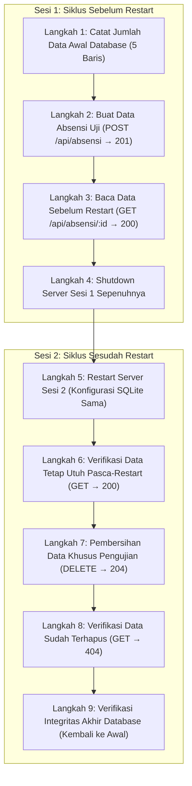

# Laporan Pengujian API Absensi Mahasiswa — Latihan Individu Pertemuan 8

Dokumentasi pengujian otomatis (*automated integration & persistence testing*) untuk memverifikasi fungsionalitas, validasi input, kepatuhan kode status HTTP, dan persistensi basis data pada REST API Sistem Informasi Absensi Mahasiswa.

---

## 1. Identitas Tugas

* **Mata Kuliah:** Praktikum Backend Web Framework (SI-VA-Backend)
* **Pertemuan:** Pertemuan 8 — Pengujian REST API dan Persistensi Basis Data
* **Tugas:** Latihan Individu Pertemuan 8
* **Nama Mahasiswa:** Della Kartika
* **NIM:** 240160221008
* **Kelas:** SI-VA
* **Direktori Tugas:** `Della-Kartika-240160221008/Pertemuan-8/Latihan-Individu/`
* **Studi Kasus:** Sistem Informasi Absensi Mahasiswa

---

## 2. Tujuan Pengujian

Tujuan dari pengujian pada Latihan Individu Pertemuan 8 adalah:
1. Memverifikasi seluruh endpoint utama API Absensi bekerja sesuai spesifikasi standar RESTful API (kode status 200, 201, 204, dan 404).
2. Menguji ketahanan gerbang validasi input (pengujian negatif) terhadap field kosong, kesalahan tipe data, nilai di luar domain status (`Hadir`, `Izin`, `Sakit`, `Alpa`), format tanggal tidak valid, panjang karakter berlebih, dan payload kosong dengan memastikan status HTTP 400 Bad Request dikembalikan dengan pesan yang tepat.
3. Menguji persistensi basis data fisik SQLite (`prisma/absensi-della-kartika.db`) untuk membuktikan bahwa data yang dibuat melalui endpoint POST tetap tersimpan dan dapat diakses kembali setelah server Express dimatikan sepenuhnya dan di-restart.
4. Memastikan integritas basis data tetap bersih tanpa meninggalkan artefak data sementara uji.

---

## 3. Objek Pengujian dan Lokasi Proyek

* **Lokasi Objek Pengujian:**  
  `Della-Kartika-240160221008/Pertemuan-8/UTS/240160221008-della-kartika/`
* **Arsitektur API Objek Uji:**  
  Arsitektur berlapis (*Layered Architecture*) yang memisahkan tanggung jawab secara ketat:
  * `app.ts` & `server.ts`: Inisialisasi Express, middleware parsing JSON, routing utama `/api/absensi`, endpoint kesehatan `/api/health`, dan penanganan error global.
  * `src/routes/absensi.routes.ts`: Lapisan routing HTTP Express.
  * `src/controller/absensi.controller.ts`: Lapisan validasi tipe data gerbang `typeof`, validasi domain status kehadiran, validasi tanggal ISO, dan penyusunan respon HTTP.
  * `src/service/absensi.service.ts`: Lapisan logika bisnis murni dan manipulasi data melalui Prisma ORM.
  * `src/config/client.ts` & `client.ts`: Singleton instance PrismaClient dengan driver `@prisma/adapter-better-sqlite3`.
* **File Basis Data Fisik:**  
  `Della-Kartika-240160221008/Pertemuan-8/UTS/240160221008-della-kartika/prisma/absensi-della-kartika.db`

---

## 4. Teknologi yang Digunakan

| Komponen | Paket / Teknologi | Versi Deklarasi | Peran dalam Proyek & Pengujian |
|---|---|:---:|---|
| **Runtime** | Node.js | `v24.15.0` | Menjalankan server dan skrip pengujian via native TypeScript execution (`--experimental-strip-types`) |
| **Web Framework** | `express` | `^5.3.0` | Framework server HTTP dan routing API objek uji |
| **ORM Client** | `@prisma/client` | `^7.10.1` | Object-Relational Mapping untuk kueri data absensi |
| **Database Adapter** | `@prisma/adapter-better-sqlite3` | `^7.10.1` | Driver adapter SQLite resmi untuk Prisma v7 |
| **Database Engine** | `better-sqlite3` | `^13.0.3` | Driver SQLite lokal berkinerja tinggi |
| **Konfigurasi Env** | `dotenv` | `^18.0.9` | Pemuat variabel lingkungan database dan port |
| **Bahasa Pemrograman** | `typescript` | `^7.0.2` | Compiler dan pemeriksaan tipe statis |
| **Type Definitions** | `@types/express`, `@types/node` | `^5.0.6`, `^26.6.2` | Definisi tipe statis Express dan Node.js |
| **CLI Perkakas** | `prisma` | `^7.10.1` | Prisma CLI untuk migrasi dan generate client |
| **HTTP Client Uji** | Native Fetch API | Bawaan Node.js | Mengirim HTTP request otomatis ke endpoint uji |

---

## 5. Daftar Skenario Pengujian Endpoint dan Validasi Negatif

Pengujian fungsional dan pengujian negatif diimplementasikan pada skrip [`test-latihan-8.ts`](file:///d:/SI-VA-Backend/Della-Kartika-240160221008/Pertemuan-8/Latihan-Individu/test-latihan-8.ts) dengan mencakup 25 skenario uji:

### Aturan Validasi Aktual Lapisan Controller (`absensi.controller.ts`)
* **Field `nim`**: String tidak kosong, maksimal 30 karakter.
* **Field `namaMahasiswa`**: String tidak kosong, maksimal 100 karakter.
* **Field `kelas`**: String tidak kosong, maksimal 50 karakter.
* **Field `tanggal`**: String tanggal ISO 8601 yang valid (`!Number.isNaN(Date.parse(tanggal))`).
* **Field `status`**: Wajib salah satu dari empat nilai domain: `"Hadir"`, `"Izin"`, `"Sakit"`, atau `"Alpa"`.
* **Field `keterangan`**: Opsional, jika disertakan harus berupa string maksimal 255 karakter.
* **Parameter `:id`**: Bilangan bulat positif (`/^[1-9]\d*$/`).
* **PATCH Body**: Objek tidak boleh kosong `{}`.

---

## 6. Hasil Pengujian Fungsional (25/25 PASS)

Eksekusi skrip `test-latihan-8.ts` menghasilkan tingkat keberhasilan **100% (25 LULUS, 0 GAGAL)**:

| No | Skenario Pengujian | Endpoint / Target | Status Diharapkan | Status Aktual | Hasil |
|:---:|---|---|:---:|:---:|:---:|
| 1 | Pemeriksaan kesehatan API dan koneksi database SQLite | `GET /api/health` | 200 | 200 | **PASS** |
| 2 | Mengambil seluruh daftar data absensi (kondisi awal) | `GET /api/absensi` | 200 | 200 | **PASS** |
| 3 | Membuat data absensi baru dengan payload valid | `POST /api/absensi` | 201 | 201 | **PASS** |
| 4 | Mengambil detail absensi yang baru dibuat | `GET /api/absensi/:id` | 200 | 200 | **PASS** |
| 5 | Mengambil detail absensi dengan ID tidak terdaftar | `GET /api/absensi/999999` | 404 | 404 | **PASS** |
| 6 | Memperbarui sebagian data absensi secara valid | `PATCH /api/absensi/:id` | 200 | 200 | **PASS** |
| 7 | Menghapus data absensi uji (HTTP 204 No Content) | `DELETE /api/absensi/:id` | 204 | 204 | **PASS** |
| 8 | Verifikasi data uji telah terhapus dari basis data | `GET /api/absensi/:id` | 404 | 404 | **PASS** |
| 9 | POST: Field `nim` berupa spasi kosong | `POST /api/absensi` | 400 | 400 | **PASS** |
| 10 | POST: Field `namaMahasiswa` tidak disertakan | `POST /api/absensi` | 400 | 400 | **PASS** |
| 11 | POST: Field `kelas` tidak disertakan | `POST /api/absensi` | 400 | 400 | **PASS** |
| 12 | POST: Format `tanggal` tidak valid | `POST /api/absensi` | 400 | 400 | **PASS** |
| 13 | POST: Nilai `status` di luar domain yang diizinkan | `POST /api/absensi` | 400 | 400 | **PASS** |
| 14 | POST: Panjang field `nim` melebihi 30 karakter | `POST /api/absensi` | 400 | 400 | **PASS** |
| 15 | POST: Panjang field `namaMahasiswa` melebihi 100 karakter | `POST /api/absensi` | 400 | 400 | **PASS** |
| 16 | PATCH: Payload body kosong `{}` | `PATCH /api/absensi/:id` | 400 | 400 | **PASS** |
| 17 | PATCH: Field `nim` berupa spasi kosong | `PATCH /api/absensi/:id` | 400 | 400 | **PASS** |
| 18 | PATCH: Field `namaMahasiswa` berupa spasi kosong | `PATCH /api/absensi/:id` | 400 | 400 | **PASS** |
| 19 | PATCH: Field `kelas` berupa spasi kosong | `PATCH /api/absensi/:id` | 400 | 400 | **PASS** |
| 20 | PATCH: Format `tanggal` tidak valid | `PATCH /api/absensi/:id` | 400 | 400 | **PASS** |
| 21 | PATCH: Nilai `status` di luar pilihan yang diizinkan | `PATCH /api/absensi/:id` | 400 | 400 | **PASS** |
| 22 | PATCH: Panjang field `keterangan` melebihi 255 karakter | `PATCH /api/absensi/:id` | 400 | 400 | **PASS** |
| 23 | PATCH: Parameter ID bukan bilangan bulat positif (`'abc'`) | `PATCH /api/absensi/abc` | 400 | 400 | **PASS** |
| 24 | Pembersihan data sementara uji PATCH | `DELETE /api/absensi/:id` | 204 | 204 | **PASS** |
| 25 | Verifikasi integritas database (kembali ke jumlah awal) | `Database State Check` | Awal | Awal | **PASS** |

---

## 7. Prosedur Pengujian Persistensi Setelah Server Restart

Pengujian persistensi pada skrip [`test-persistence.ts`](file:///d:/SI-VA-Backend/Della-Kartika-240160221008/Pertemuan-8/Latihan-Individu/test-persistence.ts) memvalidasi penyimpanan fisik ke disk basis data SQLite melewati siklus hidup server secara penuh yang terbagi ke dalam **9 tahapan pengujian**:



---

## 8. Hasil Pengujian Persistensi (9/9 PASS)

Eksekusi skrip `test-persistence.ts` membuktikan bahwa data tersimpan secara non-volatil ke dalam file `prisma/absensi-della-kartika.db` dan lulus **100% (9 LULUS, 0 GAGAL)**:

| No | Tahap Pengujian | Status Diharapkan | Status Aktual | Hasil |
|:---:|---|:---:|:---:|:---:|
| 1 | Pencatatan data awal basis data | `5 baris` | `5 baris` | **PASS** |
| 2 | Pembuatan data absensi uji (`POST /api/absensi`) | `201 Created` | `201 Created` | **PASS** |
| 3 | Pembacaan data sebelum restart (`GET /api/absensi/:id`) | `200 OK` | `200 OK` | **PASS** |
| 4 | Shutdown server sesi 1 secara tuntas | *Closed* | *Closed* | **PASS** |
| 5 | Restart server sesi 2 dengan konfigurasi sama | *Listening* | *Listening* | **PASS** |
| 6 | Verifikasi data tetap ada pasca-restart (`GET /api/absensi/:id`) | `200 OK` | `200 OK` | **PASS** |
| 7 | Penghapusan data uji sementara (`DELETE /api/absensi/:id`) | `204 No Content` | `204 No Content` | **PASS** |
| 8 | Verifikasi data sudah tidak ada (`GET /api/absensi/:id`) | `404 Not Found` | `404 Not Found` | **PASS** |
| 9 | Verifikasi integritas jumlah baris database akhir | `5 baris` | `5 baris` | **PASS** |

---

## 9. Cara Menjalankan Skrip Pengujian

### Langkah 1: Masuk ke Direktori Latihan Pertemuan 8
```powershell
cd Della-Kartika-240160221008/Pertemuan-8/Latihan-Individu
```

### Langkah 2: Menjalankan Pengujian Fungsional dan Negatif (25 Skenario)
```powershell
$env:NODE_PATH=(Resolve-Path "..\UTS\240160221008-della-kartika\node_modules").Path
node --experimental-strip-types test-latihan-8.ts
```

### Langkah 3: Menjalankan Pengujian Persistensi dan Siklus Restart (9 Tahapan)
```powershell
$env:NODE_PATH=(Resolve-Path "..\UTS\240160221008-della-kartika\node_modules").Path
node --experimental-strip-types test-persistence.ts
```

---

## 10. Kesimpulan

Berdasarkan seluruh hasil pengujian yang telah dilaksanakan pada Latihan Individu Pertemuan 8:
1. **Kepatuhan Kontrak API:** REST API Sistem Informasi Absensi Mahasiswa pada proyek UTS terbukti mematuhi standar perancangan RESTful API dengan kode status yang tepat (200 OK, 201 Created, 204 No Content, 400 Bad Request, dan 404 Not Found).
2. **Ketahanan Validasi Input:** Lapisan Controller berhasil menolak seluruh data cacat (field wajib kosong, string spasi kosong, format tanggal tidak valid, nilai status di luar Hadir/Izin/Sakit/Alpa, panjang karakter melebihi batas, dan payload kosong) sebelum menyentuh lapisan database.
3. **Persistensi Terverifikasi:** Basis data SQLite terbukti bekerja secara persisten (*non-volatile storage*). Data berhasil disimpan ke piringan disk lokal (`prisma/absensi-della-kartika.db`) dan tidak hilang saat server dimatikan secara total maupun di-restart.
4. **Kebersihan dan Integritas Basis Data:** Seluruh pengujian membersihkan data uji sementara pada akhir sesi, menjaga integritas jumlah baris database tetap bersih.
