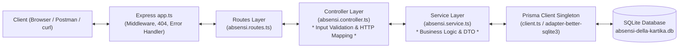

# UTS Mini Project Backend — Sistem Informasi Absensi Mahasiswa

Repositori ini berisi implementasi resmi **UTS Mini Project Backend** berupa layanan RESTful API untuk pengelolaan sistem informasi absensi mahasiswa. Proyek backend ini dibangun dengan arsitektur berlapis (*layered architecture*: Routes, Controller, Service), menggunakan Express.js, TypeScript, dan Prisma ORM dengan basis data SQLite yang persisten.

---

## 1. Identitas Mahasiswa & Pemilik Project

| Atribut | Keterangan |
|---|---|
| **Nama Mahasiswa** | Della Kartika |
| **NIM** | 240160221008 |
| **Kelas** | SI-VA |
| **Program Studi** | Sistem Informasi |
| **Mata Kuliah** | Praktikum Backend Web Framework |
| **Pertemuan** | Pertemuan 8 |
| **Jenis Tugas** | UTS Mini Project Backend |
| **Studi Kasus** | Sistem Informasi Absensi Mahasiswa |
| **Nama Project** | `absensi-della-kartika` |
| **Resource Utama** | `absensi` |

---

## 2. Deskripsi Project

Sistem Informasi Absensi Mahasiswa merupakan backend REST API yang dirancang untuk mengelola pencatatan kehadiran mahasiswa dalam kegiatan perkuliahan secara terstruktur, aman, dan efisien. Sistem berfokus pada resource utama `absensi` tanpa membuat tabel atau relasi CRUD terpisah yang membingungkan, sehingga alur pencatatan kehadiran berlangsung cepat dan terintegrasi.

Aplikasi ini mendukung operasi CRUD (*Create, Read, Update, Delete*) lengkap, validasi data masukan secara ketat (*strict input validation*), penanganan error terpusat (*centralized error handling*), pemutusan koneksi server secara aman (*graceful shutdown*), serta persistensi data fisik SQLite yang telah diverifikasi melewati siklus restart server.

---

## 3. Tujuan Project

1. Mengimplementasikan perancangan RESTful API sesuai spesifikasi arsitektur backend modern.
2. Menerapkan pola arsitektur berlapis (*Routes, Controller, Service*) guna menjamin pemisahan tanggung jawab (*separation of concerns*).
3. Menggunakan TypeScript native execution (`--experimental-strip-types`) pada Node.js modern tanpa kompilasi build yang lambat.
4. Menerapkan Prisma ORM v7 dengan adapter `@prisma/adapter-better-sqlite3` untuk basis data SQLite.
5. Membangun gerbang validasi input ketat guna menjaga integritas data dan mencegah injeksi kesalahan pada database.
6. Memverifikasi persistensi data non-volatil pada piringan disk lokal (`prisma/absensi-della-kartika.db`).

---

## 4. Teknologi dan Dependensi

| Komponen | Paket / Runtime | Versi | Peran dalam Proyek |
|---|---|:---:|---|
| **Runtime** | Node.js | `>=22.6.0` (Aktual: `v24.15.0`) | Menjalankan kode TypeScript secara native |
| **Web Framework** | Express.js | `^5.3.0` | Penanganan HTTP server, middleware, dan routing |
| **ORM** | Prisma | `^7.10.1` | Object-Relational Mapping & Database Schema Migration |
| **Database Adapter** | `@prisma/adapter-better-sqlite3` | `^7.10.1` | Adapter resmi SQLite untuk Prisma v7 |
| **Database Engine** | `better-sqlite3` | `^13.0.3` | Mesin SQLite berkinerja tinggi |
| **Environment** | `dotenv` | `^18.0.9` | Pemuat variabel lingkungan dari berkas `.env` |
| **Bahasa** | TypeScript | `^7.0.2` | Pengetikan statis dan validasi tipe kode |
| **Type Definitions** | `@types/express`, `@types/node` | `^5.0.6`, `^26.6.2` | Tipe data untuk Express dan Node.js runtime |

---

## 5. Fitur Utama

1. **Operasi CRUD Lengkap Resource Absensi**:
   - `GET /api/absensi`: Mengambil seluruh daftar catatan absensi (mendukung filter query `?status=...`).
   - `GET /api/absensi/:id`: Mengambil detail absensi berdasarkan ID unik (integer positif).
   - `POST /api/absensi`: Menambahkan catatan absensi baru dengan validasi ketat.
   - `PATCH /api/absensi/:id`: Memperbarui sebagian field absensi secara parsial.
   - `DELETE /api/absensi/:id`: Menghapus data absensi berdasarkan ID (HTTP 204 No Content).
2. **Endpoint Pendukung & Health Check**:
   - `GET /`: Informasi ringkasan status REST API dan identitas pemilik.
   - `GET /api/health` & `GET /health`: Pemeriksaan konektivitas database fisik SQLite melalui query `SELECT 1`.
3. **Pola Singleton Prisma Client**:
   - Menghindari pembuatan koneksi berulang (*multiple instances*) dengan facade di `client.ts` dan implementasi di `src/config/client.ts`.
4. **Validasi Input Ketat (*Strict Input Validation*)**:
   - Pengecekan tipe data primitif `typeof` pada semua field.
   - Penolakan string kosong atau hanya karakter spasi (*whitespace only*).
   - Batasan status kehadiran hanya 4 pilihan: `Hadir`, `Izin`, `Sakit`, `Alpa`.
   - Validasi format tanggal ISO 8601 yang valid.
   - Batasan panjang maksimal karakter setiap field (`nim` <= 30, `namaMahasiswa` <= 100, `kelas` <= 50, `keterangan` <= 255).
   - Penolakan request body kosong `{}` pada endpoint PATCH.
5. **Graceful Shutdown**:
   - Menangani sinyal sistem operasi `SIGINT` (Ctrl+C) dan `SIGTERM`.
   - Menghentikan penerimaan request HTTP baru, menunggu koneksi aktif selesai, dan memutuskan koneksi Prisma Client (`prisma.$disconnect()`) secara bersih.
6. **Database Seeding**:
   - Skrip `npm run prisma:seed` untuk mengisi data awal uji perkuliahan.
7. **Automated Test Suite**:
   - Skrip pengujian otomatis `npm test` mencakup 19 skenario pengujian fungsional, pengujian negatif, dan pengujian persistensi server restart (100% PASS).

---

## 6. Struktur Direktori Proyek

```text
240160221008-della-kartika/
│
├── app.ts                  # Konfigurasi middleware Express, routing, 404, dan central error handler
├── server.ts               # Inisialisasi HTTP server, startup banner, dan graceful shutdown
├── client.ts               # Facade singleton Prisma Client di root
├── prisma.config.ts        # Konfigurasi Prisma 7 (schema path, migrations, datasource URL)
├── package.json            # Definisi dependensi dan executable scripts
├── package-lock.json       # Lockfile versi dependensi
├── tsconfig.json           # Konfigurasi compiler TypeScript (Node16 module resolution)
├── .env.example            # Template variabel lingkungan (PORT dan DATABASE_URL)
├── .env                    # Variabel lingkungan aktif (lokal, diabaikan git)
├── .gitignore              # Proteksi node_modules, .env, dan database lokal
├── README.md               # Dokumentasi resmi proyek UTS
├── test.ts                 # Skrip pengujian otomatis komprehensif (19 skenario)
│
├── prisma/
│   ├── schema.prisma       # Definisi model data Absensi dan datasource SQLite
│   ├── seed.ts             # Skrip database seed data awal perkuliahan
│   ├── absensi-della-kartika.db # Database fisik SQLite
│   └── migrations/         # Riwayat migrasi DDL database
│       ├── migration_lock.toml
│       └── 20261102083203_init_absensi/
│           └── migration.sql # File DDL pembuatan tabel absensi
│
└── src/
    ├── config/
    │   └── client.ts       # Inisialisasi adapter better-sqlite3 dan singleton PrismaClient
    │
    ├── controller/
    │   └── absensi.controller.ts # Validasi payload HTTP, parsing parameter, dan respons JSON
    │
    ├── routes/
    │   └── absensi.routes.ts     # Pendaftaran rute endpoint /api/absensi
    │
    └── service/
        └── absensi.service.ts    # Logika bisnis, query Prisma ORM, dan custom NotFoundError
```

---

## 7. Desain Database

### Tabel `absensi`

| Nama Field | Tipe Data Prisma | Tipe Data SQLite | Keterangan | Atribut / Constraint |
|---|---|---|---|---|
| `id` | `Int` | `INTEGER` | Identifikator unik data absensi | Primary Key, Auto Increment |
| `nim` | `String` | `TEXT` | Nomor Induk Mahasiswa | NOT NULL |
| `namaMahasiswa` | `String` | `TEXT` | Nama lengkap mahasiswa | NOT NULL |
| `kelas` | `String` | `TEXT` | Kelas mahasiswa (misal: Informatika) | NOT NULL |
| `tanggal` | `DateTime` | `DATETIME` | Tanggal perkuliahan / absensi | NOT NULL |
| `status` | `String` | `TEXT` | Status kehadiran (`Hadir`/`Izin`/`Sakit`/`Alpa`) | NOT NULL |
| `keterangan` | `String?` | `TEXT` | Catatan tambahan kehadiran | NULLABLE (Opsional) |
| `createdAt` | `DateTime` | `DATETIME` | Waktu pencatatan data dibuat | Default: waktu sekarang (`CURRENT_TIMESTAMP`) |
| `updatedAt` | `DateTime` | `DATETIME` | Waktu pembaruan data terakhir | Otomatis diperbarui (@updatedAt) |

### File Skema Prisma (`prisma/schema.prisma`)

```prisma
generator client {
  provider = "prisma-client"
  output   = "../generated/prisma"
}

datasource db {
  provider = "sqlite"
}

model Absensi {
  id            Int      @id @default(autoincrement())
  nim           String
  namaMahasiswa String
  kelas         String
  tanggal       DateTime
  status        String
  keterangan    String?
  createdAt     DateTime @default(now())
  updatedAt     DateTime @updatedAt

  @@map("absensi")
}
```

---

## 8. Arsitektur Backend (Layered Architecture)

Aplikasi mengadopsi pola arsitektur tiga lapis (*Three-Layer Architecture*):



Tanggung jawab masing-masing lapisan:
- **Routes (`src/routes/absensi.routes.ts`)**: Mendaftarkan pola URI HTTP dan memetakan method (GET, POST, PATCH, DELETE) ke fungsi controller terkait.
- **Controller (`src/controller/absensi.controller.ts`)**: Menerima request HTTP, melakukan validasi gerbang `typeof` dan aturan bisnis input, mengekstrak parameter, serta menyusun format respon status HTTP yang sesuai.
- **Service (`src/service/absensi.service.ts`)**: Berisi logika manipulasi data murni, berkomunikasi dengan Prisma ORM, dan melempar custom error (`NotFoundError`) jika record tidak ditemukan.
- **Prisma Client Singleton (`src/config/client.ts` & `client.ts`)**: Mengelola koneksi database secara efisien melalui driver `better-sqlite3`.

---

## 9. Konfigurasi Environment

Berkas template `.env.example`:

```env
DATABASE_URL="file:./prisma/absensi-della-kartika.db"
PORT=3008
```

- `DATABASE_URL`: Alamat protokol file basis data SQLite fisik lokal.
- `PORT`: Port server HTTP lokal (default: `3008`).

---

## 10. Panduan Instalasi dan Menjalankan Proyek

### 1. Masuk ke Direktori Proyek
```bash
cd Della-Kartika-240160221008/Pertemuan-8/UTS/240160221008-della-kartika
```

### 2. Pasang Dependensi
```bash
npm install
```

### 3. Siapkan Konfigurasi Lingkungan
Salin file `.env.example` menjadi `.env`:
- **Windows (PowerShell):**
  ```powershell
  Copy-Item .env.example .env
  ```
- **Linux / macOS:**
  ```bash
  cp .env.example .env
  ```

### 4. Eksekusi Migrasi Database Prisma
Buat tabel dan indeks pada SQLite:
```bash
npm run prisma:migrate
```

### 5. Generate Prisma Client
```bash
npm run prisma:generate
```

### 6. (Opsional) Mengisi Data Seed Awal
```bash
npm run prisma:seed
```

### 7. Menjalankan Server
- **Mode Pengembangan (Hot-Reload):**
  ```bash
  npm run dev
  ```
- **Mode Standar:**
  ```bash
  npm start
  ```
Server akan aktif di: `http://localhost:3008`

---

## 11. Dokumentasi Endpoint REST API

| Method | Endpoint | Fungsi | Status Sukses | Status Error |
|---|---|---|:---:|:---:|
| `GET` | `/` | Menampilkan ringkasan status server | 200 | - |
| `GET` | `/api/health` | Pemeriksaan kesehatan server dan database | 200 | 500 |
| `GET` | `/api/absensi` | Mengambil seluruh data absensi (opsi query `?status=...`) | 200 | 400 |
| `GET` | `/api/absensi/:id` | Mengambil detail absensi berdasarkan ID | 200 | 400, 404 |
| `POST` | `/api/absensi` | Menambahkan data absensi baru | 201 | 400 |
| `PATCH` | `/api/absensi/:id` | Memperbarui sebagian data absensi | 200 | 400, 404 |
| `DELETE` | `/api/absensi/:id` | Menghapus data absensi berdasarkan ID | 204 | 400, 404 |

---

## 12. Contoh Request & Response JSON

### A. GET Seluruh Data Absensi (`GET /api/absensi`)
**Request:**
```http
GET /api/absensi HTTP/1.1
Host: localhost:3008
```

**Response (HTTP 200 OK):**
```json
{
  "success": true,
  "total": 1,
  "data": [
    {
      "id": 1,
      "nim": "240160221008",
      "namaMahasiswa": "Della Kartika",
      "kelas": "Informatika",
      "tanggal": "2026-11-02T08:00:00.000Z",
      "status": "Hadir",
      "keterangan": "Mengikuti perkuliahan praktikum backend",
      "createdAt": "2026-11-02T08:32:03.123Z",
      "updatedAt": "2026-11-02T08:32:03.123Z"
    }
  ]
}
```

### B. GET Detail Absensi (`GET /api/absensi/:id`)
**Request:**
```http
GET /api/absensi/1 HTTP/1.1
Host: localhost:3008
```

**Response (HTTP 200 OK):**
```json
{
  "success": true,
  "data": {
    "id": 1,
    "nim": "240160221008",
    "namaMahasiswa": "Della Kartika",
    "kelas": "Informatika",
    "tanggal": "2026-11-02T08:00:00.000Z",
    "status": "Hadir",
    "keterangan": "Mengikuti perkuliahan praktikum backend",
    "createdAt": "2026-11-02T08:32:03.123Z",
    "updatedAt": "2026-11-02T08:32:03.123Z"
  }
}
```

### C. POST Tambah Data Absensi (`POST /api/absensi`)
**Request:**
```http
POST /api/absensi HTTP/1.1
Host: localhost:3008
Content-Type: application/json

{
  "nim": "240160221008",
  "namaMahasiswa": "Della Kartika",
  "kelas": "Informatika",
  "tanggal": "2026-11-02T08:00:00.000Z",
  "status": "Hadir",
  "keterangan": "Mengikuti perkuliahan praktikum backend"
}
```

**Response (HTTP 201 Created):**
```json
{
  "success": true,
  "message": "Data absensi berhasil ditambahkan",
  "data": {
    "id": 2,
    "nim": "240160221008",
    "namaMahasiswa": "Della Kartika",
    "kelas": "Informatika",
    "tanggal": "2026-11-02T08:00:00.000Z",
    "status": "Hadir",
    "keterangan": "Mengikuti perkuliahan praktikum backend",
    "createdAt": "2026-11-02T08:35:10.500Z",
    "updatedAt": "2026-11-02T08:35:10.500Z"
  }
}
```

### D. PATCH Perbarui Data Absensi (`PATCH /api/absensi/:id`)
**Request:**
```http
PATCH /api/absensi/2 HTTP/1.1
Host: localhost:3008
Content-Type: application/json

{
  "status": "Izin",
  "keterangan": "Izin menghadiri seminar akademik"
}
```

**Response (HTTP 200 OK):**
```json
{
  "success": true,
  "message": "Data absensi berhasil diperbarui",
  "data": {
    "id": 2,
    "nim": "240160221008",
    "namaMahasiswa": "Della Kartika",
    "kelas": "Informatika",
    "tanggal": "2026-11-02T08:00:00.000Z",
    "status": "Izin",
    "keterangan": "Izin menghadiri seminar akademik",
    "createdAt": "2026-11-02T08:35:10.500Z",
    "updatedAt": "2026-11-02T08:36:20.100Z"
  }
}
```

### E. DELETE Hapus Data Absensi (`DELETE /api/absensi/:id`)
**Request:**
```http
DELETE /api/absensi/2 HTTP/1.1
Host: localhost:3008
```

**Response (HTTP 204 No Content):**
*(Tidak memiliki response body)*

### F. Respons Negatif Validasi Gagal (HTTP 400 Bad Request)
```json
{
  "success": false,
  "message": "Status tidak valid. Nilai yang diperbolehkan hanya: Hadir, Izin, Sakit, Alpa"
}
```

### G. Respons Negatif Data Tidak Ditemukan (HTTP 404 Not Found)
```json
{
  "success": false,
  "message": "Data absensi dengan ID 999 tidak ditemukan"
}
```

---

## 13. Contoh Perintah cURL Lengkap

### 1. Health Check
```bash
curl -X GET http://localhost:3008/api/health
```

### 2. Mengambil Seluruh Catatan Absensi
```bash
curl -X GET http://localhost:3008/api/absensi
```

### 3. Mengambil Seluruh Catatan Absensi dengan Filter Status
```bash
curl -X GET "http://localhost:3008/api/absensi?status=Hadir"
```

### 4. Menambahkan Catatan Absensi Baru (POST)
```bash
curl -X POST http://localhost:3008/api/absensi \
  -H "Content-Type: application/json" \
  -d '{
    "nim": "240160221008",
    "namaMahasiswa": "Della Kartika",
    "kelas": "Informatika",
    "tanggal": "2026-11-02T08:00:00.000Z",
    "status": "Hadir",
    "keterangan": "Mengikuti perkuliahan UTS"
  }'
```

### 5. Mengambil Detail Absensi Berdasarkan ID (GET :id)
```bash
curl -X GET http://localhost:3008/api/absensi/1
```

### 6. Memperbarui Catatan Absensi Secara Parsial (PATCH :id)
```bash
curl -X PATCH http://localhost:3008/api/absensi/1 \
  -H "Content-Type: application/json" \
  -d '{
    "status": "Izin",
    "keterangan": "Izin tugas dinas luar kampus"
  }'
```

### 7. Menghapus Catatan Absensi (DELETE :id)
```bash
curl -X DELETE http://localhost:3008/api/absensi/1
```

---

## 14. Penjelasan Kode Status HTTP

| Kode Status | Kategori | Penggunaan pada Sistem Absensi |
|:---:|---|---|
| **200 OK** | Success | Pengambilan daftar data (`GET /api/absensi`), detail data (`GET /api/absensi/:id`), dan pembaruan parsial (`PATCH /api/absensi/:id`). |
| **201 Created** | Success | Penambahan record data absensi baru berhasil (`POST /api/absensi`). |
| **204 No Content** | Success | Penghapusan data absensi berhasil (`DELETE /api/absensi/:id`) tanpa badan respons. |
| **400 Bad Request** | Client Error | Kesalahan validasi data masukan (field wajib kosong, format tanggal tidak valid, status tidak sesuai domain, payload PATCH kosong, atau sintaks JSON malformed). |
| **404 Not Found** | Client Error | ID data absensi tidak ditemukan di basis data atau endpoint URI yang dipanggil tidak terdaftar. |
| **500 Internal Server Error** | Server Error | Terjadi kegagalan koneksi database atau pengecualian yang tidak terduga pada server. |

---

## 15. Prosedur Pengujian dan Persistensi

Proyek ini telah dilengkapi dengan skrip pengujian otomatis komprehensif pada berkas `test.ts`.

### Menjalankan Pengujian Otomatis (19 Skenario)
```bash
npm test
```

### Hasil Pengujian Fungsional dan Persistensi (19/19 PASS):
1. **GET `/api/health`**: Konektivitas server dan database SQLite berfungsi normal (**PASS**).
2. **GET `/api/absensi`**: Berhasil mengambil array data awal (**PASS**).
3. **POST `/api/absensi`**: Berhasil menambahkan data absensi baru (Status 201) (**PASS**).
4. **GET `/api/absensi/:id`**: Berhasil mengambil detail data absensi (Status 200) (**PASS**).
5. **PATCH `/api/absensi/:id`**: Berhasil memperbarui data status absensi (Status 200) (**PASS**).
6. **GET `/api/absensi?status=Izin`**: Filter query parameter berfungsi akurat (**PASS**).
7. **POST Field Kosong**: Menolak `nim` string kosong dengan status 400 (**PASS**).
8. **POST Format Tanggal Rusak**: Menolak format tanggal non-ISO dengan status 400 (**PASS**).
9. **POST Status Tidak Valid**: Menolak nilai status di luar daftar dengan status 400 (**PASS**).
10. **PATCH Body Kosong `{}`**: Menolak payload kosong dengan status 400 (**PASS**).
11. **PATCH Status Tidak Valid**: Menolak status salah pada saat pembaruan (status 400) (**PASS**).
12. **GET ID Tidak Ditemukan**: Mengembalikan status 404 (**PASS**).
13. **DELETE ID Tidak Ditemukan**: Mengembalikan status 404 (**PASS**).
14. **Middleware 404**: Endpoint tidak dikenal mengembalikan pesan 404 terstruktur (**PASS**).
15. **DELETE `/api/absensi/:id`**: Berhasil menghapus data dengan status 204 No Content (**PASS**).
16. **Verifikasi Penghapusan**: Data yang telah dihapus mengembalikan status 404 (**PASS**).
17. **Persistensi Sesi 1**: Membuat record baru sebelum server dihentikan (**PASS**).
18. **Persistensi Sesi 2 (Server Restart)**: Server instance baru menyala dan memverifikasi data di disk SQLite fisik tetap utuh (**PASS**).
19. **Pembersihan Data Uji**: Menjaga integritas basis data tetap bersih (**PASS**).
