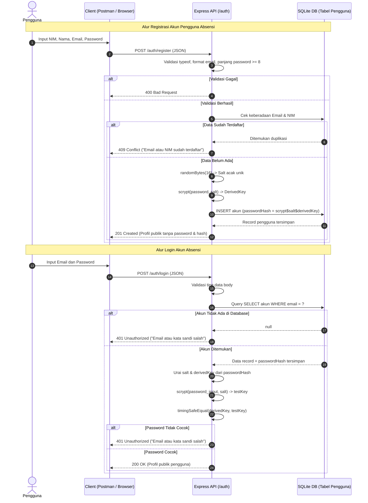

# Aktivitas Kelompok — Pertemuan 9
## Perancangan Alur Authentication: Register, Login, dan Password Hashing

### Identitas Kelompok
* **Kelompok:** 1
* **Anggota Kelompok:**
  1. Della Kartika
  2. Nadya Zahra Aulia
  3. Rico Muhammad F
  4. Nabilla Natasya Putri

---

## 1. Deskripsi Aktivitas

Aktivitas kelompok Pertemuan 9 berfokus pada perancangan mekanisme autentikasi (*authentication*) pada backend RESTful API. Autentikasi adalah fondasi keamanan sistem yang berfungsi memverifikasi keaslian identitas pengguna saat mengakses layanan melalui pembuktian kredensial rahasia (kombinasi email/NIM dan kata sandi).

Perancangan ini disesuaikan dengan studi kasus kelompok, yaitu **Sistem Informasi Absensi Mahasiswa**. Dalam sistem absensi perkuliahan, autentikasi sangat krusial guna memastikan bahwa:
1. Catatan kehadiran mahasiswa (status Hadir, Izin, Sakit, atau Alpa) hanya dapat diinput oleh akun mahasiswa yang sah atau administrator perkuliahan.
2. Mencegah manipulasi atau pemalsuan presensi kehadiran oleh pihak yang tidak berhak.
3. Kredensial akun seluruh mahasiswa dan dosen tersimpan secara aman dalam database tanpa risiko kebocoran kata sandi.

---

## 2. Rancangan Tabel Input dan Kontrak Endpoint

Layanan autentikasi mengimplementasikan dua endpoint dasar:
1. `POST /auth/register` — Pendaftaran akun pengguna sistem absensi.
2. `POST /auth/login` — Autentikasi identitas pengguna untuk mengakses sistem.

### 2.1 Spesifikasi Input Endpoint Register (`POST /auth/register`)

| Field | Tipe Data | Wajib / Opsional | Batasan dan Format | Keterangan |
|---|:---:|:---:|---|---|
| `nim` | String | Wajib | 10–20 digit numerik, unik di database | Nomor Induk Mahasiswa untuk verifikasi data absensi |
| `nama` | String | Wajib | 2–100 karakter teks, tidak boleh kosong/spasi | Nama lengkap mahasiswa / pengguna |
| `email` | String | Wajib | Format email RFC 5322 valid, unik di database | Alamat email resmi untuk notifikasi dan login |
| `password` | String | Wajib | Minimal 8 karakter | Kata sandi akun (plaintext saat dikirim client) |

### 2.2 Spesifikasi Input Endpoint Login (`POST /auth/login`)

| Field | Tipe Data | Wajib / Opsional | Batasan dan Format | Keterangan |
|---|:---:|:---:|---|---|
| `email` | String | Wajib | Format email valid, teks tidak kosong | Identitas akun yang ingin masuk |
| `password` | String | Wajib | Teks tidak kosong | Kredensial rahasia pembuktian kepemilikan akun |

---

## 3. Gerbang Validasi Input

Lapisan controller Express menjalankan inspeksi data masukan secara ketat:

1. **Validasi Tipe Primitif (`typeof`)**:
   Memastikan request body berbentuk JSON object dan setiap field bernilai string. Input bertipe non-string (seperti number, boolean, array, atau null) ditolak dengan status HTTP `400 Bad Request`.
2. **Pembersihan Whitespace (`trim()`)**:
   Mencegah injeksi string yang hanya terdiri dari karakter spasi. Field yang kosong setelah di-trim akan ditolak.
3. **Pemeriksaan Format Email & NIM**:
   - `email` divalidasi dengan regex standar email.
   - `nim` divalidasi harus berupa kumpulan karakter angka numerik berukuran 8–20 digit.
4. **Panjang Password**:
   Kata sandi wajib memiliki panjang minimal 8 karakter untuk mempersulit serangan berbasis tebakan (*brute force*).
5. **Perlindungan Terhadap Mass Assignment**:
   Pengguna publik dilarang menentukan field `role`. Jika request body mengandung properti `role`, server mengembalikan respons `400 Bad Request`.

---

## 4. Operasi Database & Pengelolaan Password Hashing

### 4.1 Hashing Satu Arah vs Enkripsi Dua Arah
* **Enkripsi**: Data dapat dikembalikan ke teks asli (*reversible*) menggunakan kunci dekripsi. Sangat berbahaya jika digunakan untuk menyimpan password, karena kebocoran kunci di server akan membocorkan seluruh password pengguna.
* **Hashing**: Transformasi matematis satu arah (*irreversible*). Password diubah menjadi nilai deret heksadesimal yang tidak dapat dibalik. Verifikasi dilakukan dengan mencocokkan hash hasil kalkulasi ulang password masukan dengan hash yang ada di database.

### 4.2 Algoritma `scrypt` dan Salt Unik
Aplikasi memanfaatkan modul bawaan Node.js (`node:crypto`) dengan algoritma `scrypt`:
1. **Pembangkitan Salt**: Setiap kali pengguna mendaftar, server menghasilkan 16 byte nilai acak menggunakan fungsi `randomBytes(16)`.
2. **Fungsi Salt**: Menjamin bahwa password yang sama dari dua pengguna berbeda akan menghasilkan nilai hash yang sama sekali berbeda di database, sehingga kebal terhadap serangan kamus terindeks (*Rainbow Table Attacks*).
3. **Karakteristik Memory-Hard**: `scrypt` membutuhkan sumber daya memori dan siklus komputasi yang tinggi, menjadikannya sangat lambat untuk diserang menggunakan perangkat akselerator GPU atau perangkat keras ASIC.
4. **Format Penyimpanan**: Hash disimpan dalam database dengan format terstandardisasi:
   ```text
   scrypt$<salt-hex>$<derived-key-hex>
   ```

### 4.3 Verifikasi Kredensial Login yang Aman
Saat proses login:
1. Server mencari akun berdasarkan `email`. Jika tidak ditemukan, respons `401 Unauthorized` langsung dikirim.
2. Jika akun ditemukan, server mengekstrak nilai `salt` dan `derivedKey` tersimpan dari kolom `passwordHash`.
3. Server menghitung kunci turunan dari kata sandi masukan client dengan `salt` tersebut.
4. Kunci turunan dibandingkan menggunakan fungsi `timingSafeEqual(bufferA, bufferB)`.
   *Penggunaan `timingSafeEqual` memastikan waktu perbandingan konstan tanpa bergantung pada letak karakter yang berbeda, sehingga melindungi server dari serangan kebocoran waktu komputasi (Timing Attacks).*

---

## 5. Respons Sistem dan Penanganan Kegagalan

Sistem menerapkan prinsip *Information Security* agar respons API tidak membocorkan informasi sensitif:

| Skenario | Status Code | Respons JSON | Alasan Keamanan |
|---|:---:|---|---|
| Pendaftaran Berhasil | `201 Created` | `{"success": true, "message": "Pendaftaran akun berhasil", "data": {"id": 1, "nim": "...", "nama": "...", "email": "...", "role": "mahasiswa"}}` | Hanya mengembalikan profil publik. **Field password dan passwordHash tidak pernah disertakan**. |
| Input Tidak Valid | `400 Bad Request` | `{"success": false, "message": "Password minimal harus 8 karakter"}` | Menegakkan integritas kontrak request body. |
| Duplikasi Email / NIM | `409 Conflict` | `{"success": false, "message": "Email sudah terdaftar"}` | Menolak konflik data unik pada tabel basis data. |
| Login Berhasil | `200 OK` | `{"success": true, "message": "Autentikasi berhasil", "data": {"id": 1, "nim": "...", "nama": "...", "email": "...", "role": "mahasiswa"}}` | Kredensial terverifikasi. Mengembalikan profil pengguna. |
| Password Salah / Email Belum Ada | `401 Unauthorized` | `{"success": false, "message": "Email atau kata sandi salah"}` | **Pesan kegagalan seragam**. Mencegah penyerang mengetahui apakah sebuah email sudah terdaftar atau belum (*User Enumeration Mitigation*). |
| Kesalahan Internal | `500 Internal Server Error` | `{"success": false, "message": "Terjadi kesalahan pada server"}` | Detail error teknis disembunyikan dari client dan hanya dicatat pada log server. |

---

## 6. Diagram Alur Autentikasi (Sequence Diagram)

Berikut alur komunikasi antara client, Express API, dan database SQLite pada Sistem Informasi Absensi:



---

## 7. Kesimpulan dan Tinjauan Desain

1. **Keamanan Presensi Absensi**: Dengan diterapkannya autentikasi pada endpoint, sistem informasi absensi memiliki identitas resmi setiap mahasiswa yang melakukan presensi kegiatan.
2. **Perlindungan Terhadap Enumerasi**: Respons penolakan login menggunakan pesan seragam `"Email atau kata sandi salah"` guna melindungi privasi daftar email mahasiswa di kampus.
3. **Pemisahan Peran**: Pertemuan 9 berfokus pada autentikasi kredensial. Penerbitan token akses (JWT) dan proteksi rute absensi berdasarkan peran pengguna (*Authorization*) akan diimplementasikan pada Pertemuan 10.

