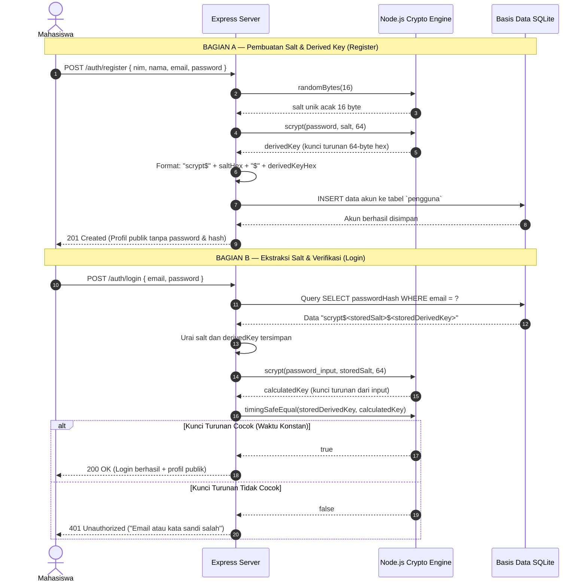

# Laporan Latihan Individu — Pertemuan 9
## Autentikasi, Password Hashing, dan Validasi Identitas Pengguna

* **Nama Mahasiswa:** Della Kartika
* **NIM:** 240160221008
* **Mata Kuliah:** Praktikum Backend Web Framework (SI-VA)
* **Pertemuan:** Pertemuan 9
* **Studi Kasus:** Sistem Informasi Absensi Mahasiswa

---

## 1. Subsoal 1: Penambahan NIM sebagai Identitas Unik Kedua dan Validasi Format

Dalam Sistem Informasi Absensi Mahasiswa, NIM (*Nomor Induk Mahasiswa*) adalah identitas primer yang memetakan presensi kehadiran fisik dengan rekam jejak akademik resmi mahasiswa. Setiap akun yang terdaftar wajib memiliki NIM yang valid dan tidak boleh terduplikasi.

### Implementasi Validasi
Validasi NIM pada sistem absensi diterapkan dengan aturan:
- Tipe data harus string (`typeof nim === "string"`).
- Panjang karakter antara 8 hingga 20 digit.
- Seluruh isi karakter harus berupa digit numerik angka (`/^\d+$/`).

Kode implementasi pada `latihan-9.ts`:
```typescript
export const isValidNIM = (nim: unknown): { valid: boolean; message?: string } => {
  if (typeof nim !== "string") {
    return { valid: false, message: "NIM harus berupa teks (string)" };
  }
  const cleanNIM = nim.trim();
  if (cleanNIM.length < 8 || cleanNIM.length > 20) {
    return { valid: false, message: "Panjang NIM harus antara 8 hingga 20 digit" };
  }
  if (!/^\d+$/.test(cleanNIM)) {
    return { valid: false, message: "NIM hanya boleh terdiri dari digit angka (0-9)" };
  }
  return { valid: true };
};
```

Pada skema database Prisma SQLite, NIM didefinisikan dengan constraint `@unique`:
```prisma
model Pengguna {
  id           Int      @id @default(autoincrement())
  nim          String   @unique
  nama         String
  email        String   @unique
  passwordHash String
  role         String   @default("mahasiswa")
  createdAt    DateTime @default(now())
}
```

---

## 2. Subsoal 2: Pengujian Login Benar/Salah, Email Tidak Terdaftar, dan Tipe Field Keliru

Pengujian dilakukan secara otomatis menggunakan skrip [`test-latihan-9.ts`](./test-latihan-9.ts).

### Hasil Eksekusi Pengujian:

| No | Skenario Pengujian | Input yang Diuji | Status Diharapkan | Status Aktual | Hasil |
|:---:|---|---|:---:|:---:|:---:|
| 1 | Validasi NIM numerik valid | `"240160221008"` | Valid | Valid | **PASS** |
| 2 | Validasi NIM mengandung huruf | `"24016022DEL"` | Invalid | Invalid | **PASS** |
| 3 | Validasi NIM terlalu pendek | `"123"` | Invalid | Invalid | **PASS** |
| 4 | Validasi NIM tipe data objek | `{ nim: "..." }` | Invalid | Invalid | **PASS** |
| 5 | Login dengan kredensial benar | Email & password cocok | 200 OK | 200 OK | **PASS** |
| 6 | Login dengan password salah | Password keliru | 401 Unauthorized | 401 Unauthorized | **PASS** |
| 7 | Login dengan email tidak terdaftar | Email belum ada di DB | 401 Unauthorized | 401 Unauthorized | **PASS** |
| 8 | Login dengan tipe data keliru | Email bertipe `boolean` | 400 Bad Request | 400 Bad Request | **PASS** |
| 9 | Verifikasi kebersihan respons | Payload respons | Tanpa hash | Tanpa hash | **PASS** |

**Kesimpulan Pengujian:** 9 dari 9 pengujian lulus (100% PASS). Pesan kegagalan login diseragamkan menjadi `"Email atau kata sandi salah"` sehingga tidak membocorkan keberadaan akun di database.

---

## 3. Subsoal 3: Mengapa Hash Tidak Boleh Dikirim sebagai Pengganti Password pada Respons dan Mengapa Hash Bukan Kredensial?

Terdapat alasan keamanan mendasar dalam arsitektur backend REST API:

1. **Perlindungan Terhadap Serangan *Pass-the-Hash***:
   Jika server menerima hash sebagai pengganti password atau jika hash dikirim ke klien, siapa pun yang berhasil mencuri hash (melalui XSS, sniffing jaringan, atau log) dapat langsung menggunakannya untuk login (*impersonation*). Hash yang dapat dipakai untuk autentikasi langsung kehilangan sifat keamanannya dan berubah menjadi password plaintext kedua.
2. **Mencegah Serangan Komputasi *Offline Cracking***:
   Meskipun `scrypt` adalah fungsi yang lambat dan berat memori, membocorkan hash ke publik memberi kesempatan bagi penyerang untuk mencoba serangan kamus (*dictionary attack*) atau tebakan *brute-force* secara offline di perangkat mereka tanpa terhalang mekanisme proteksi server seperti rate limiting atau IP blocking.
3. **Prinsip *Need-to-Know* dan *Least Privilege***:
   Klien hanya memerlukan data profil publik pengguna (`id`, `nim`, `nama`, `email`) untuk kebutuhan antarmuka pengguna. Klien tidak pernah membutuhkan nilai hash untuk merender UI absensi.

---

## 4. Subsoal 4: Sequence Diagram Pembuatan Salt dan Verifikasi Login

Berikut visualisasi proses kriptografi pembentukan salt acak dan verifikasi waktu konstan (*constant-time verification*):



---

## 5. Cara Menjalankan Skrip Pengujian

Untuk memverifikasi implementasi latihan individu:
```bash
cd Della-Kartika-240160221008/pertemuan-9/Latihan-Individu
node --experimental-strip-types test-latihan-9.ts
```

