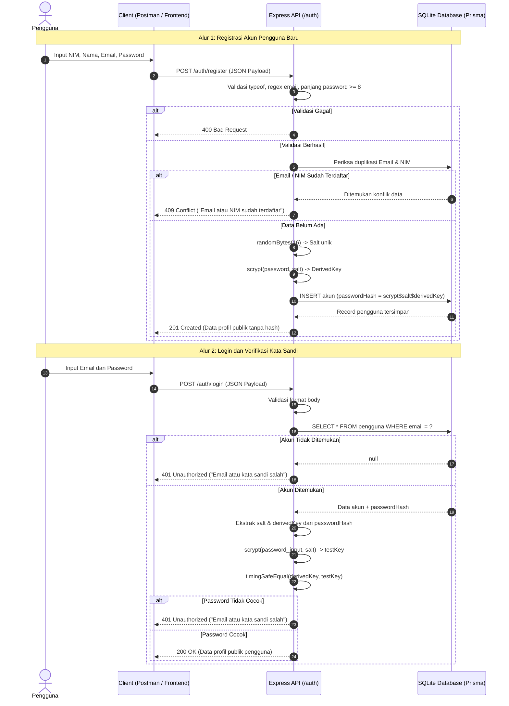

# Aktivitas Kelompok — Pertemuan 9
## Perancangan Alur Authentication: Register, Login, dan Password Hashing

### Identitas Kelompok
* **Kelompok:** 2
* **Anggota Kelompok:**
  1. Muhammad Zaky
  2. Alya Ayu Meysha
  3. Sandika Yusuf Permana
  4. Imam Abdillah Aulia

---

## 1. Deskripsi Aktivitas

Aktivitas kelompok Pertemuan 9 membahas perancangan alur autentikasi (*authentication*) pada backend RESTful API. Autentikasi adalah proses verifikasi identitas pengguna (apakah pengguna benar-benar pihak yang diklaim) menggunakan kredensial rahasia berupa kombinasi email/NIM dan kata sandi (*password*).

Perancangan ini dilakukan untuk domain kelompok, yaitu **Sistem Informasi Akademik / Manajemen Data Mahasiswa**. Sistem akademik membutuhkan autentikasi agar mahasiswa dan staf akademik dapat mengelola data profil serta kegiatan akademik secara aman, tanpa risiko pembajakan akun atau kebocoran kredensial tersimpan.

---

## 2. Rancangan Tabel Input dan Kontrak Endpoint

Endpoint autentikasi dasar terdiri dari dua aksi utama:
1. `POST /auth/register` — Pendaftaran akun pengguna baru.
2. `POST /auth/login` — Verifikasi kredensial untuk masuk ke dalam sistem.

### 2.1 Spesifikasi Input Endpoint Register (`POST /auth/register`)

| Field | Tipe Data | Wajib / Opsional | Batasan dan Format | Keterangan |
|---|:---:|:---:|---|---|
| `nim` | String | Wajib | 10–20 karakter, hanya karakter alfanumerik / angka, unik di database | Identitas nomor induk mahasiswa |
| `nama` | String | Wajib | 2–100 karakter teks, tidak boleh kosong/whitespace | Nama lengkap pengguna |
| `email` | String | Wajib | Format email RFC 5322 (`^[^\s@]+@[^\s@]+\.[^\s@]+$`), unik di database | Alamat surat elektronik resmi |
| `password` | String | Wajib | Minimal 8 karakter, kombinasi teks/simbol | Kata sandi akun (plaintext dari client) |

### 2.2 Spesifikasi Input Endpoint Login (`POST /auth/login`)

| Field | Tipe Data | Wajib / Opsional | Batasan dan Format | Keterangan |
|---|:---:|:---:|---|---|
| `email` | String | Wajib | Format email valid, teks tidak kosong | Kredensial identitas akun |
| `password` | String | Wajib | Teks tidak kosong | Kredensial pembuktian rahasia |

---

## 3. Gerbang Validasi Input

Server Express menerapkan validasi berlapis sebelum data diteruskan ke lapisan service atau database:

1. **Pengecekan Tipe Primitif (`typeof`)**:
   Setiap field diperiksa tipenya. Jika client mengirim `number`, `boolean`, `array`, atau `null` pada field string, server langsung menolak dengan status HTTP `400 Bad Request`.
2. **Sanitasi Whitespace**:
   Field `nim`, `nama`, dan `email` dilakukan pembersihan spasi di awal dan akhir (`trim()`). Jika hasil `trim()` berupa string kosong, request dianggap tidak valid.
3. **Format Email**:
   Pengecekan ekspresi reguler memastikan email mengandung karakter sebelum dan sesudah simbol `@` serta memiliki domain yang sah.
4. **Panjang Password**:
   Password divalidasi memiliki panjang minimal 8 karakter guna memenuhi standar ketahanan terhadap serangan kamus (*dictionary attack*).
5. **Penolakan Field Ilegal**:
   Client tidak diperkenankan menyuntikkan field `role` pada saat registrasi mandiri publik. Field `role` selalu diatur secara default menjadi `mahasiswa` di sisi server.

---

## 4. Operasi Database & Pengelolaan Password Hashing

### 4.1 Mengapa Hashing, Bukan Enkripsi?
* **Enkripsi** adalah proses dua arah (*two-way function*) yang membutuhkan kunci rahasia (*secret key*) untuk mengenkripsi dan mendekripsi data. Jika kunci server bocor, seluruh password pengguna akan terbaca.
* **Hashing** adalah proses matematis satu arah (*one-way cryptographic function*). Nilai hash tidak dapat dibalik menjadi password asli. Server memverifikasi kecocokan password dengan cara menghitung ulang nilai hash dari password masukan dan membandingkannya dengan hash yang tersimpan di basis data.

### 4.2 Algoritma `scrypt` dan Salt Unik
Praktikum menggunakan fungsi kriptografi `scrypt` bawaan runtime Node.js (`node:crypto`). Algoritma `scrypt` dirancang khusus sebagai *password-based key derivation function* yang membutuhkan alokasi memori dan waktu komputasi terkontrol (*memory-hard and CPU-intensive*), sehingga tangguh terhadap serangan *brute force* menggunakan GPU atau perangkat keras ASIC.

Langkah pembentukan hash pada pendaftaran akun:
1. Server membangkitkan *salt* acak sebanyak 16 byte menggunakan `randomBytes(16)`.
2. *Salt* unik menjamin bahwa dua pengguna yang memiliki password identik akan menghasilkan nilai hash tersimpan yang sama sekali berbeda (*mencegah serangan Rainbow Table*).
3. Turunan kunci (*derived key*) dihitung menggunakan `scrypt(password, salt, 64)`.
4. Nilai akhir disimpan dalam satu kolom database berformat terstruktur:
   ```text
   scrypt$<salt-hex>$<derived-key-hex>
   ```
   *Catatan:* Salt bukan merupakan rahasia (*secret*) dan secara standar disimpan bersama hash agar dapat digunakan kembali saat login.

### 4.3 Verifikasi Kredensial Saat Login
1. Server mencari record pengguna di basis data SQLite berdasarkan `email`.
2. Jika akun tidak ditemukan, verifikasi dihentikan dan sistem mengembalikan `401 Unauthorized`.
3. Jika akun ditemukan, server mengurai (*parse*) string `passwordHash` tersimpan untuk memperoleh nilai `salt` dan `derivedKey` tersimpan.
4. Server menghitung ulang turunan kunci dari password yang dimasukkan client menggunakan `salt` tersebut.
5. Kedua turunan kunci dibandingkan menggunakan fungsi `timingSafeEqual(bufferA, bufferB)`.
   *Fungsi `timingSafeEqual` mengeksekusi perbandingan dengan waktu konstan terlepas dari letak byte yang berbeda, sehingga mencegah serangan analisis waktu (Timing Attacks).*

---

## 5. Respons Sistem dan Penanganan Kegagalan

Sistem mengimplementasikan kode status HTTP semantik dan format respons JSON terstandarisasi:

| Kondisi | Status Code | Format Respons JSON | Keterangan |
|---|:---:|---|---|
| Registrasi Berhasil | `201 Created` | `{"success": true, "message": "Pendaftaran akun berhasil", "data": {"id": 1, "nim": "...", "nama": "...", "email": "...", "role": "mahasiswa"}}` | Hanya mengembalikan profil publik. **Field password dan hash tidak dikirim**. |
| Input Tidak Valid | `400 Bad Request` | `{"success": false, "message": "Email wajib diisi dengan format yang benar"}` | Format atau panjang field tidak memenuhi kontrak. |
| Email / NIM Telah Terdaftar | `409 Conflict` | `{"success": false, "message": "Email atau NIM sudah terdaftar"}` | Menolak duplikasi data unik pada tabel basis data. |
| Login Berhasil | `200 OK` | `{"success": true, "message": "Autentikasi berhasil", "data": {"id": 1, "nim": "...", "nama": "...", "email": "...", "role": "mahasiswa"}}` | Kredensial terverifikasi. Mengembalikan profil pengguna. |
| Kredensial Salah / Akun Tidak Ada | `401 Unauthorized` | `{"success": false, "message": "Email atau kata sandi salah"}` | **Pesan umum seragam**. Tidak membocorkan apakah email terdaftar atau password yang keliru (*mencegah User Enumeration*). |
| Kesalahan Internal Server | `500 Internal Server Error` | `{"success": false, "message": "Terjadi kesalahan pada server"}` | Kesalahan tak terduga ditangani central error handler tanpa membocorkan pesan database ke client. |

---

## 6. Diagram Alur Autentikasi (Sequence Diagram)

Berikut alur interaksi client, Express server, dan SQLite database:



---

## 7. Kesimpulan dan Tinjauan Desain

1. **Perlindungan Kredensial**: Password dalam bentuk teks biasa hanya berada sesaat dalam memori proses saat request berlangsung dan segera dikonversi menjadi hash sebelum operasi database.
2. **Pencegahan User Enumeration**: Respons kegagalan login sengaja diseragamkan dengan pesan `"Email atau kata sandi salah"` agar penyerang tidak dapat memetakan email mana yang aktif dalam sistem akademik.
3. **Pemisahan Konsep**: Aktivitas Pertemuan 9 berfokus murni pada *Authentication* (pembuktian identitas akun). Mekanisme penerbitan token sesi (JWT) dan pembatasan hak akses (*Authorization*) akan dilanjutkan pada Pertemuan 10.

