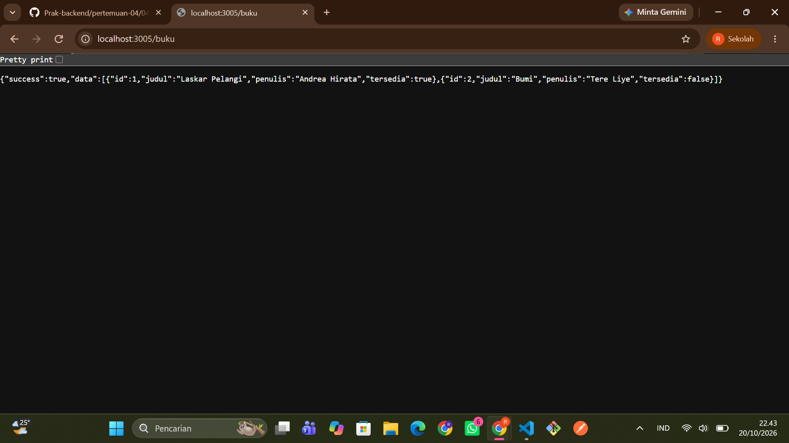
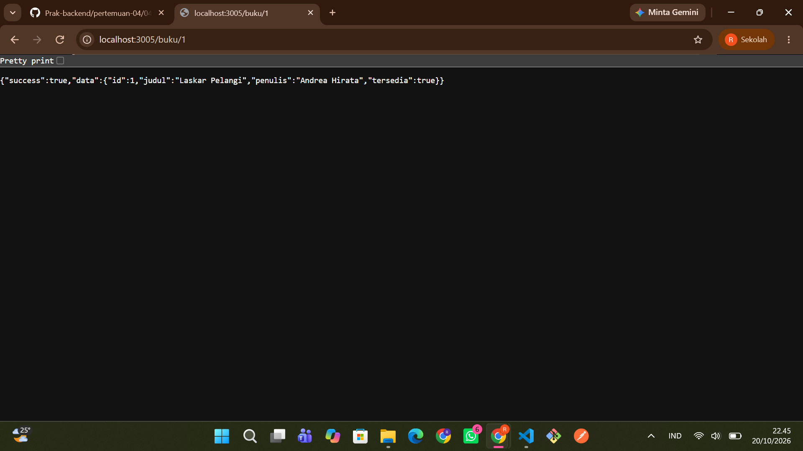
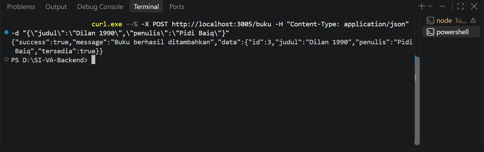
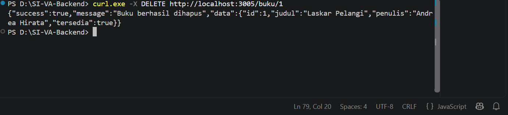
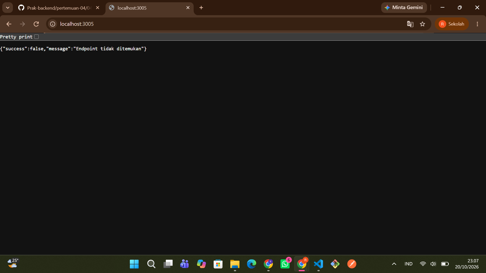

# Tugas 2 — REST Endpoint dengan Express.js

**Nama : Rissa Srihandita**
**NPM : 240160221041**

Aplikasi backend berbasis **Express.js** yang menyediakan RESTful API untuk pengelolaan resource **buku**.

## 1. Struktur Project

```text
Tugas-2/
├── app.js
├── server.js
├── package-lock.json
├── package.json
├── README.md
└── screenshot/
    ├── GET_buku.png
    ├── GET_bukuid.png
    ├── POST_buku.png
    ├── DELETE-buku.png
    └── ERROR.png
```

## 2. Cara Menjalankan Aplikasi

### Masuk ke folder project

```bash
cd Tugas-2
```

### Install dependensi

```bash
npm install
```

### Jalankan aplikasi 

```bash
npm run dev
```

Server akan berjalan di:

```text
http://localhost:3005
```

## 3. Daftar Endpoint

| Method | Endpoint | Deskripsi | Keterangan |
|---|---|---|---|
| GET | `/buku` | Mendapatkan seluruh daftar buku | Mendukung Query Parameter `?tersedia=true/false` |
| GET | `/buku/:id` | Mendapatkan detail buku berdasarkan ID | Menggunakan Route Parameter `:id` |
| POST | `/buku` | Menambahkan buku baru | Membutuhkan Body JSON (`judul`, `penulis`) |
| DELETE | `/buku/:id` | Menghapus buku berdasarkan ID | Menggunakan Route Parameter `:id` |

## 4. Contoh Request (cURL)

### 4.1 GET Semua Buku

```powershell
curl http://localhost:3005/buku
```

### 4.2 GET Detail Buku berdasarkan ID

```powershell
curl http://localhost:3005/buku/1
```

### 4.3 POST Tambah Buku Baru

```powershell
curl.exe --% -X POST http://localhost:3005/buku -H "Content-Type: application/json" -d "{\"judul\":\"Dilan 1990\",\"penulis\":\"Pidi Baiq\"}"
```

### 4.4 DELETE Hapus Buku berdasarkan ID

```powershell
curl.exe -X DELETE http://localhost:3005/buku/1
```

## 5. Hasil Pengujian API

### 5.1 Response GET `/buku`

**Status Code: 200 OK**



### 5.2 Response GET `/buku/:id`

**Status Code: 200 OK**



### 5.3 Response POST `/buku`

**Status Code: 201 Created**



### 5.4 Response DELETE `/buku/:id`

**Status Code: 200 OK**



### 5.5 Response Handler 404 — Endpoint Tidak Ditemukan

**Status Code: 404 Not Found**



## 6. Ringkasan

RESTful API ini menyediakan empat endpoint utama untuk mengelola resource **buku**, yaitu mengambil seluruh data buku, mengambil detail buku berdasarkan ID, menambahkan buku baru, dan menghapus buku berdasarkan ID. API berjalan menggunakan Express.js pada port `3005` dan menggunakan format JSON untuk request maupun response.