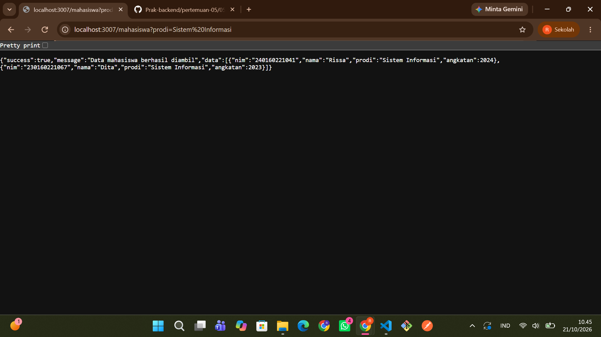
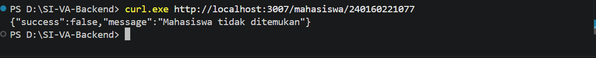
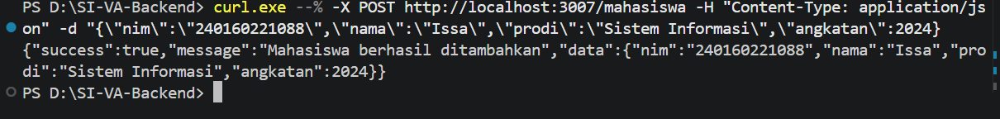
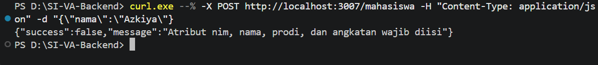
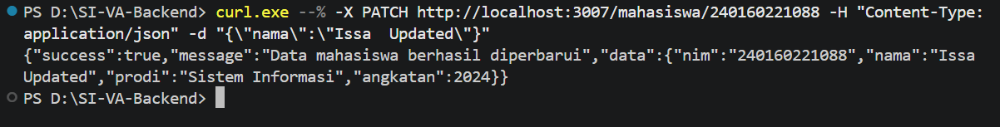
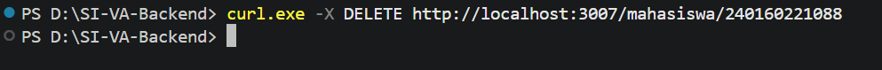

# Hasil Pengujian API (Pertemuan 5)

**Nama : Rissa Srihandita**
**NPM : 240160221041**

Berikut adalah daftar pengujian endpoint menggunakan `curl` beserta status code yang dihasilkan.

> **Catatan:** Response JSON pada setiap pengujian dicantumkan dalam bentuk **foto/screenshot hasil pengujian**.

---

## 1. GET `/mahasiswa` — Filter Prodi

- **Method**: `GET`
- **URL**: `http://localhost:3007/mahasiswa?prodi=Sistem%20Informasi`
- **Status Code**: `200 OK`
- **Response JSON**: Screenshot hasil pengujian di bawah.

---

## 2. GET `/mahasiswa/:nim` — NIM Tidak Ditemukan

- **Method**: `GET`
- **URL**: `curl.exe http://localhost:3007/mahasiswa/240160221077`
- **Status Code**: `404 Not Found`
- **Response JSON**: Screenshot hasil pengujian di bawah.

---

## 3. POST `/mahasiswa` — Tambah Mahasiswa Berhasil

- **Method**: `POST`
- **URL**: `curl.exe --% -X POST http://localhost:3007/mahasiswa -H "Content-Type: application/json" -d "{\"nim\":\"240160221088\",\"nama\":\"Issa\",\"prodi\":\"Sistem Informasi\",\"angkatan\":2024}`
- **Status Code**: `201 Created`
- **Response JSON**: Screenshot hasil pengujian di bawah.

---

## 4. POST `/mahasiswa` — Validasi Error / Field Kurang

- **Method**: `POST`
- **URL**: `curl.exe --% -X POST http://localhost:3007/mahasiswa -H "Content-Type: application/json" -d "{\"nama\":\"Azkiya\"}"`
- **Status Code**: `400 Bad Request`
- **Response JSON**: Screenshot hasil pengujian di bawah.

---

## 5. PATCH `/mahasiswa/:nim` — Ubah Sebagian Data Mahasiswa

- **Method**: `PATCH`
- **URL**: `curl.exe --% -X PATCH http://localhost:3007/mahasiswa/240160221088 -H "Content-Type: application/json" -d "{\"nama\":\"Issa Updated\"}"`
- **Status Code**: `200 OK`
- **Response JSON**: Screenshot hasil pengujian di bawah.

---

## 6. DELETE `/mahasiswa/:nim` — Hapus Mahasiswa

- **Method**: `DELETE`
- **URL**: `curl.exe -X DELETE http://localhost:3007/mahasiswa/240160221088`
- **Status Code**: `204 No Content`
- **Response Body**: Kosong
- **Response JSON**: Tidak ada karena status `204 No Content`.

---

## Ringkasan Hasil Pengujian

| No | Method | Endpoint | Pengujian | Status |
|---|---|---|---|---|
| 1 | GET | `/mahasiswa?prodi=Sistem%20Informasi` | Filter prodi | `200 OK` |
| 2 | GET | `/mahasiswa/240160221077` | NIM tidak ditemukan | `404 Not Found` |
| 3 | POST | `/mahasiswa` | Tambah mahasiswa | `201 Created` |
| 4 | POST | `/mahasiswa` | Validasi field kurang | `400 Bad Request` |
| 5 | PATCH | `/mahasiswa/240160221088` | Ubah sebagian data | `200 OK` |
| 6 | DELETE | `/mahasiswa/240160221088` | Hapus mahasiswa | `204 No Content` |
