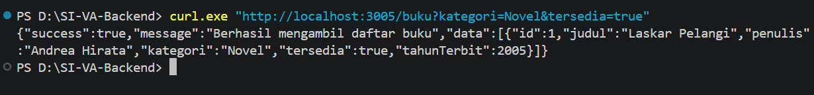
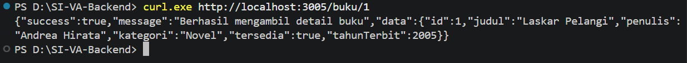
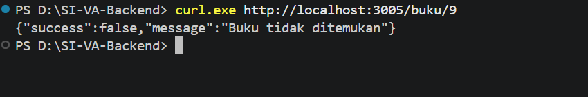
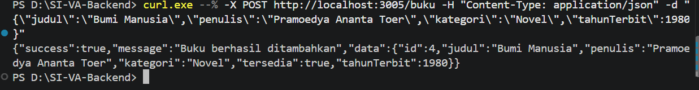
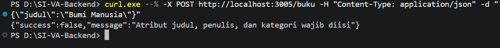
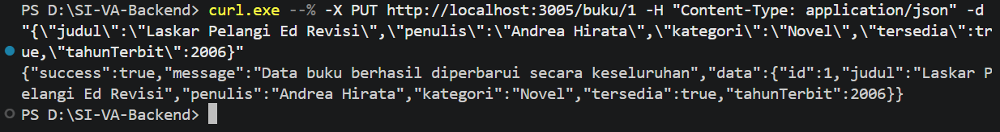
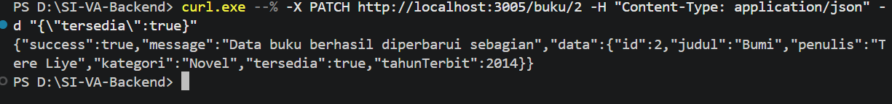
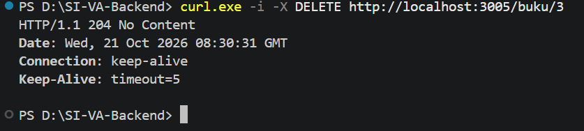
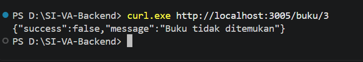

# Tugas 3 — Perancangan dan Implementasi RESTful API Express.js

**Nama : Rissa Srihandita**
**NPM : 240160221041**

Project ini merupakan implementasi RESTful API berbasis **Express.js** untuk pengelolaan resource **Buku**. API ini mendukung operasi CRUD lengkap (*Create, Read, Update, Partial Update, Delete*), validasi input, pencarian berbasis *query parameter*, serta format response JSON yang konsisten.

---

## 1. Cara Menjalankan Aplikasi

### Install Dependensi

```powershell
npm install
```

### Jalankan Server 

```powershell
npm run dev
```

Server akan berjalan secara otomatis di URL:

```text
http://localhost:3005
```

---

## 2. Contoh Request 

Jalankan perintah `curl.exe` berikut pada terminal pengujian.

### 1. GET Collection — Filter Query Parameter

```powershell
curl.exe "http://localhost:3005/buku?kategori=Novel&tersedia=true"
```

### 2. GET Detail Buku

```powershell
curl.exe http://localhost:3005/buku/1
```

### 3. GET Detail Buku — ID Tidak Ditemukan

```powershell
curl.exe http://localhost:3005/buku/9
```

### 4. POST Tambah Buku Baru

```powershell
curl.exe --% -X POST http://localhost:3005/buku -H "Content-Type: application/json" -d "{\"judul\":\"Bumi Manusia\",\"penulis\":\"Pramoedya Ananta Toer\",\"kategori\":\"Novel\",\"tahunTerbit\":1980}"
```

### 5. POST Validasi Gagal — Atribut Kurang

```powershell
curl.exe --% -X POST http://localhost:3005/buku -H "Content-Type: application/json" -d "{\"judul\":\"Bumi Manusia\"}"
```

### 6. PUT Full Update Data Buku

```powershell
curl.exe --% -X PUT http://localhost:3005/buku/1 -H "Content-Type: application/json" -d "{\"judul\":\"Laskar Pelangi Ed Revisi\",\"penulis\":\"Andrea Hirata\",\"kategori\":\"Novel\",\"tersedia\":true,\"tahunTerbit\":2006}"
```

### 7. PATCH Partial Update Data Buku

```powershell
curl.exe --% -X PATCH http://localhost:3005/buku/2 -H "Content-Type: application/json" -d "{\"tersedia\":true}"
```

### 8. DELETE Hapus Buku

```powershell
curl.exe -i -X DELETE http://localhost:3005/buku/3
```

---

## 3. Status Code & Hasil Pengujian API

> **Catatan:** Response JSON hasil pengujian dicantumkan dalam bentuk **foto/screenshot**. Simpan screenshot pada folder `screenshot` di dalam project. Nama file pada bagian berikut harus disesuaikan dengan nama file screenshot yang kamu simpan.

### 1. GET `/buku`

**Status Code: `200 OK`**

**Hasil pengujian / Response JSON:**



---

### 2. GET `/buku/:id`

**Status Code: `200 OK`**

**Hasil pengujian / Response JSON:**



---

### 3. GET `/buku/:id` — Not Found

**Status Code: `404 Not Found`**

**Hasil pengujian / Response JSON:**



---

### 4. POST `/buku` — Success

**Status Code: `201 Created`**

**Hasil pengujian / Response JSON:**



---

### 5. POST `/buku` — Bad Request

**Status Code: `400 Bad Request`**

**Hasil pengujian / Response JSON:**



---

### 6. PUT `/buku/:id` — Full Update

**Status Code: `200 OK`**

**Hasil pengujian / Response JSON:**



---

### 7. PATCH `/buku/:id` — Partial Update

**Status Code: `200 OK`**

**Hasil pengujian / Response JSON:**



---

### 8. DELETE `/buku/:id`

**Status Code: `204 No Content`**

**Response Header:** `HTTP/1.1 204 No Content`

**Response Body:** Kosong

**Hasil pengujian:**




---

## 4. Ringkasan Status Code

| No | Method | Endpoint | Pengujian | Status Code |
|---|---|---|---|---|
| 1 | GET | `/buku?kategori=Novel&tersedia=true` | Collection dengan filter | `200 OK` |
| 2 | GET | `/buku/1` | Detail buku berhasil | `200 OK` |
| 3 | GET | `/buku/999` | ID tidak ditemukan | `404 Not Found` |
| 4 | POST | `/buku` | Tambah buku berhasil | `201 Created` |
| 5 | POST | `/buku` | Validasi atribut kurang | `400 Bad Request` |
| 6 | PUT | `/buku/1` | Full update | `200 OK` |
| 7 | PATCH | `/buku/2` | Partial update | `200 OK` |
| 8 | DELETE | `/buku/3` | Hapus buku berhasil | `204 No Content` |

---

## 5. Kesimpulan

RESTful API ini berhasil mengimplementasikan pengelolaan resource **Buku** menggunakan Express.js dengan operasi collection, detail, create, update, partial update, dan delete. API juga menggunakan route parameter dan query parameter untuk pengambilan data, validasi input dengan response `400 Bad Request`, response `404 Not Found` ketika data tidak ditemukan, serta `204 No Content` untuk delete yang berhasil tanpa response body. Setiap hasil pengujian didokumentasikan melalui screenshot dan status code yang sesuai.