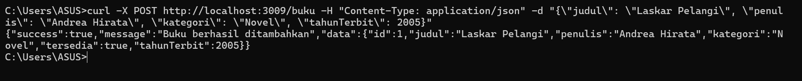
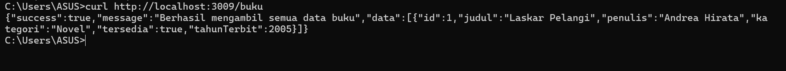
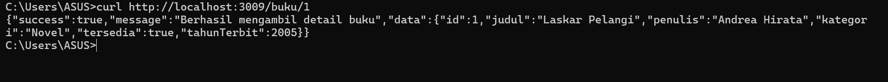
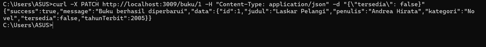
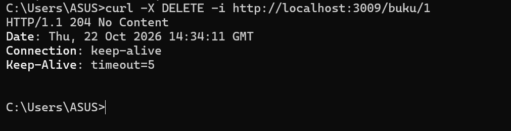
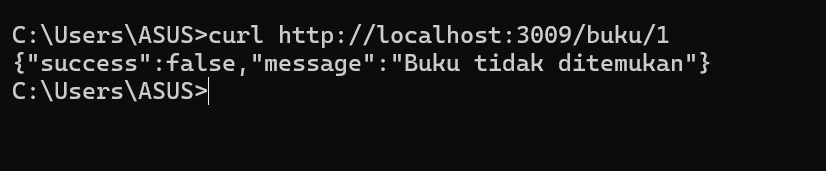

# Tugas 4 — Integrasi Database dan ORM untuk REST API

**Nama : Rissa Srihandita**
**NPM : 240160221041**

## 🚀 Langkah Instalasi & Konfigurasi

### 1. Install Dependensi

```bash
npm install
```

### 2. Konfigurasi Environment Variable

Buat file `.env` di root folder project dan isi:

```env
DATABASE_URL="file:./dev.db"
PORT=3009
```

---

## 🗄️ Database Migration (Prisma)

Untuk membuat tabel **Buku** pada database SQLite berdasarkan `prisma/schema.prisma`, jalankan:

```bash
npx prisma migrate dev --name init_buku
```

## 🏃 Memulai Server

Jalankan server Express menggunakan fitur *native TypeScript execution* Node.js:

```bash
node --experimental-strip-types app.ts
```

Server akan berjalan pada:

```text
http://localhost:3009
```

---

## 🧪 Contoh Request & Pengujian API (curl)

Berikut perintah `curl` yang dapat dijalankan melalui **Command Prompt (CMD)** untuk menguji endpoint CRUD resource **Buku**.

### 1. Tambah Data Buku (POST)

- **Method:** `POST`
- **URL:** `http://localhost:3009/buku`
- **Status Code:** `201 Created`

```cmd
curl -X POST http://localhost:3009/buku -H "Content-Type: application/json" -d "{\"judul\": \"Laskar Pelangi\", \"penulis\": \"Andrea Hirata\", \"kategori\": \"Novel\", \"tahunTerbit\": 2005}"
```



---

### 2. Ambil Semua Data Buku (GET)

- **Method:** `GET`
- **URL:** `http://localhost:3009/buku`
- **Status Code:** `200 OK`

```cmd
curl http://localhost:3009/buku
```



---

### 3. Ambil Detail Buku Berdasarkan ID (GET)

- **Method:** `GET`
- **URL:** `http://localhost:3009/buku/1`
- **Status Code:** `200 OK`

```cmd
curl http://localhost:3009/buku/1
```



---

### 4. Perbarui Data Buku Sebagian (PATCH)

- **Method:** `PATCH`
- **URL:** `http://localhost:3009/buku/1`
- **Status Code:** `200 OK`

```cmd
curl -X PATCH http://localhost:3009/buku/1 -H "Content-Type: application/json" -d "{\"tersedia\": false}"
```



---

### 5. Hapus Buku (DELETE)

- **Method:** `DELETE`
- **URL:** `http://localhost:3009/buku/1`
- **Status Code:** `204 No Content`
- **Response Body:** Kosong

```cmd
curl -X DELETE -i http://localhost:3009/buku/1
```




---