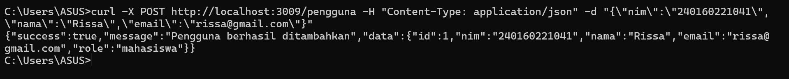
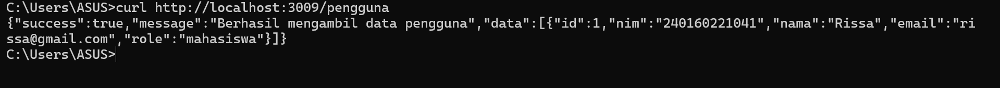
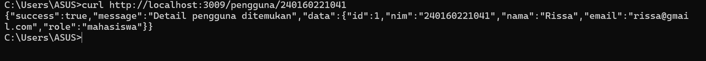
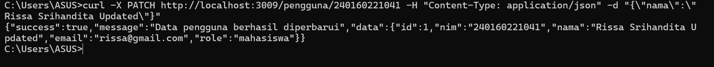
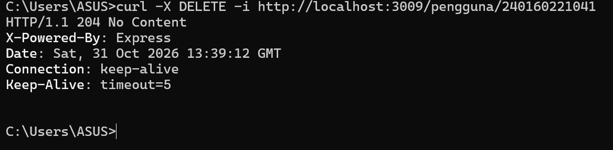
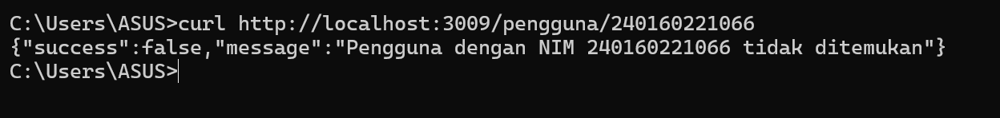

# Tugas 5 — CRUD REST API dengan Pola Service/Controller

**Nama : Rissa Srihandita**
**NPM : 240160221041**

## 🏗️ Alur Lapisan Arsitektur (Layered Architecture Flow)

Aplikasi ini memisahkan tanggung jawab kode menjadi 3 lapisan utama untuk menjaga keterbacaan, kemudahan perawatan (*maintainability*), dan fleksibilitas *testing*:

```
[ Client / Client HTTP ]
       │
       ▼
┌───────────────┐
│  Route Layer  │  (src/routes/pengguna.route.ts)
└──────┬───────┘  --> Menerima request HTTP & memetakan URL ke Controller
       │
       ▼
┌───────────────┐
│Controller Layer│ (src/controllers/pengguna.controller.ts)
└──────┬───────┘  --> Validasi input (tipe, typeof, required), tangani HTTP Status Code
       │
       ▼
┌───────────────┐
│ Service Layer │  (src/services/pengguna.service.ts)
└──────┬───────┘  --> Mengelola logika bisnis utama & interaksi ke Prisma ORM
       │
       ▼
┌───────────────┐
│   Database    │  (prisma/dev.db via Prisma Client)
└───────────────┘
```

## Langkah Menjalankan Aplikasi:

### 1. Install Dependensi

```bash
npm install
```

### 2. Konfigurasi Environment Variable

Buat file `.env` di root folder project dan isi:

```env
DATABASE_URL="file:./dev.db"
PORT=3009
```

### 3. Jalankan migrasi database dan Prisma Generate

```bash
npx prisma migrate dev --name init
```

### 4. Jalankan Server

```bash
npm run dev
```

Server akan berjalan pada:

```text
http://localhost:3009
```

## 🧪 Contoh Perintah Pengujian Endpoint (curl)

### 1. Tambah Pengguna Baru (POST)

- **Endpoint:** `POST /pengguna`
- **Status Code:** `201 Created`

```cmd
curl -X POST http://localhost:3009/pengguna -H "Content-Type: application/json" -d "{\"nim\":\"240160221041\",\"nama\":\"Rissa\",\"email\":\"rissa@gmail.com\"}"
```



---

### 2. Ambil Semua Data Pengguna (GET)

- **Endpoint:** `GET /pengguna`
- **Status Code:** `200 OK`

```cmd
curl http://localhost:3009/pengguna
```



---

### 3. Ambil Detail Pengguna Berdasarkan NIM (GET Detail)

- **Endpoint:** `GET /pengguna/:nim`
- **Status Code:** `200 OK`

```cmd
curl http://localhost:3009/pengguna/240160221041
```



---

### 4. Perbarui Data Pengguna Parsial (PATCH)

- **Endpoint:** `PATCH /pengguna/:nim`
- **Status Code:** `200 OK`

```cmd
curl -X PATCH http://localhost:3009/pengguna/240160221041 -H "Content-Type: application/json" -d "{\"nama\":\"Rissa Srihandita Updated\"}"
```



---

### 5. Hapus Data Pengguna (DELETE)

- **Endpoint:** `DELETE /pengguna/:nim`
- **Status Code:** `204 NO Content`

```cmd
curl -X DELETE -i http://localhost:3009/pengguna/240160221041
```



---

### 6. Uji Error 404 pada Detail (DELETE)

- **Endpoint:** `DELETE`
- **Status Code:** `404 Not Found`

```cmd
curl http://localhost:3009/pengguna/240160221066
```



---