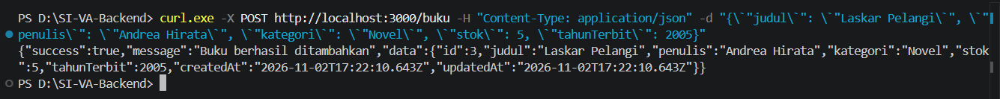
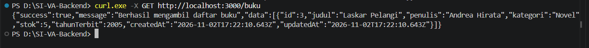
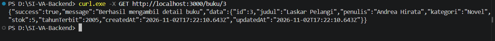
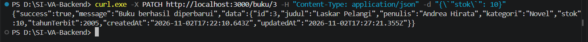
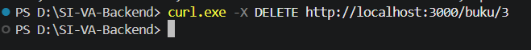
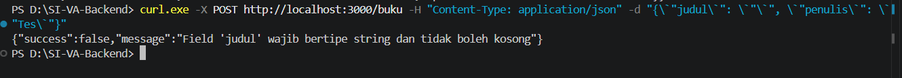
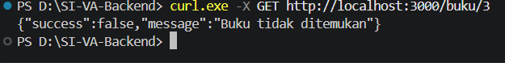

# Mini Project UTS Backend — Sistem Manajemen Perpustakaan

REST API Manajemen Data Buku Perpustakaan berbasis **Node.js, Express, TypeScript, Prisma ORM, dan database SQLite**.

**Nama : Rissa Srihandita**
**NPM : 240160221041**

---

## 1. Struktur Lapisan Proyek (Layered Architecture)

Proyek ini menerapkan *Layered Architecture* (arsitektur berlapis) sesuai dengan standar arsitektur REST API.

```text
UTS-240160221041-Rissa/
├── app.ts                     
├── server.ts                 
├── client.ts                  
├── prisma/
│   ├── schema.prisma          
│   └── migrations/           
├── .env.example               
├── package.json    
├── package-lock.json              
├── tsconfig.json              
├── README.md                  
└── src/
    ├── routes/
    │   └── buku.routes.ts     
    ├── controller/
    │   └── buku.controller.ts 
    └── service/
        └── buku.service.ts    
```

### Penjelasan Layer

1. **Route Layer (`src/routes/`)**: Menerima HTTP request pada endpoint dan mengarahkannya ke fungsi handler di Controller.
2. **Controller Layer (`src/controller/`)**: Melakukan validasi input, mengatur HTTP status code, serta menentukan format response.
3. **Service Layer (`src/service/`)**: Menangani logika bisnis dan komunikasi dengan database menggunakan Prisma Client.

---

## 2. Cara Menjalankan Proyek

### 2.1 Install Dependensi

```bash
npm install
```

### 2.2 Konfigurasi Environment Variable

Buat file `.env` dan isi dengan konfigurasi berikut:

```env
PORT=3000
DATABASE_URL="file:./dev.db"
```

### 2.3 Jalankan Migrasi Database

Jalankan Generate Prisma Client dan Migrasi Database

```bash
npx prisma generate
npx prisma migrate dev --name init
```

### 2.4 Jalankan Server

Untuk menjalankan server:

```bash
npm run dev
```

Server akan berjalan di:

```text
http://localhost:3000
```

---

## 3. Contoh Pengujian cURL Tiap Endpoint

Gunakan perintah cURL berikut pada terminal untuk menguji setiap endpoint CRUD dan penanganan error.

### 3.1 Tambah Buku Baru (POST)

- **Endpoint:** `POST /buku`
- **Expected Status Code:** `201 Created`

```powershell
curl.exe -X POST http://localhost:3000/buku -H "Content-Type: application/json" -d "{\`"judul\`": \`"Laskar Pelangi\`", \`"penulis\`": \`"Andrea Hirata\`", \`"kategori\`": \`"Novel\`", \`"stok\`": 5, \`"tahunTerbit\`": 2005}"
```


---

### 3.2 Dapatkan Semua Buku (GET) 

- **Endpoint:** `GET /buku`
- **Expected Status Code:** `200 OK`

```bash
curl.exe -X GET http://localhost:3000/buku
```


---

### 3.3 Dapatkan Detail Buku Berdasarkan ID (GET)

- **Endpoint:** `GET /buku/3`
- **Expected Status Code:** `200 OK`

```bash
curl.exe -X GET http://localhost:3000/buku/3
```


---

### 3.4 Perbarui Data Buku (PATCH)

- **Endpoint:** `PATCH /buku/3`
- **Expected Status Code:** `200 OK`

```powershell
curl.exe -X PATCH http://localhost:3000/buku/3 -H "Content-Type: application/json" -d "{\`"stok\`": 10}"
```


---

### 3.5 Hapus Buku (DELETE)

- **Endpoint:** `DELETE /buku/3`
- **Expected Status Code:** `204 No Content`

```bash
curl.exe -X DELETE http://localhost:3000/buku/3
```



*Catatan: Response dengan status 204 No Content tidak memiliki body atau pesan.*


### 3.6 Uji Validasi Gagal (POST)

- **Endpoint:** `POST /buku`
- **Expected Status Code:** `400 Bad Request`

```powershell
curl.exe -X POST http://localhost:3000/buku -H "Content-Type: application/json" -d "{\`"judul\`": \`"\`", \`"penulis\`": \`"Tes\`"}"
```


---

### 3.7 Uji Data Tidak Ditemukan (GET)

- **Endpoint:** `GET /buku/3`
- **Expected Status Code:** `404 Not Found`

```bash
curl.exe -X GET http://localhost:3000/buku/3
```


---

## 4. Ringkasan Pengujian

| No. | Method | Endpoint | Skenario Pengujian | Status Code |
|---|---|---|---|---|
| 1 | POST | `/buku` | Menambahkan buku baru | 201 Created |
| 2 | GET | `/buku` | Mengambil semua data buku | 200 OK |
| 3 | GET | `/buku/3` | Mengambil detail buku | 200 OK |
| 4 | PATCH | `/buku/3` | Memperbarui sebagian data buku | 200 OK |
| 5 | DELETE | `/buku/3` | Menghapus buku | 204 No Content |
| 6 | POST | `/buku` | Menguji validasi input gagal | 400 Bad Request |
| 7 | GET | `/buku/3` | Menguji data tidak ditemukan | 404 Not Found |

---

## 5. Kesimpulan

Mini Project UTS Backend ini merupakan REST API untuk manajemen data buku perpustakaan yang dibangun menggunakan Node.js, Express, TypeScript, Prisma ORM, dan SQLite. Proyek menerapkan *Layered Architecture* dengan memisahkan proses routing, validasi dan pengelolaan response pada Controller, serta logika bisnis dan akses database pada Service. Pengujian mencakup operasi tambah, baca, ubah, dan hapus data buku, serta pengujian validasi gagal dan data yang tidak ditemukan. Bukti hasil pengujian disertakan dalam bentuk screenshot.