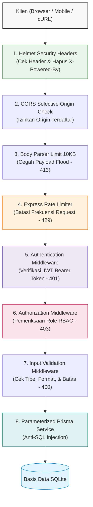

# AKTIFITAS KELOMPOK — PERTEMUAN 11
## SECURITY CHECKLIST & KEAMANAN BACKEND API

---

### IDENTITAS KELOMPOK
- **Kelompok:** 2
- **Kelas:** SI-VA
- **Mata Kuliah:** Pemrograman Backend Web Framework
- **Studi Kasus:** Sistem Informasi Akademik / Manajemen Data Mahasiswa
- **Anggota Kelompok:**
  - Muhammad Zaky
  - Alya Ayu Meysha
  - Sandika Yusuf Permana
  - Imam Abdillah Aulia

---

## 1. PENDAHULUAN & PRINSIP DEFENSE-IN-DEPTH
Pada Pertemuan 9 dan 10, Sistem Informasi Akademik telah mengintegrasikan modul autentikasi dan otorisasi berbasis JWT. Namun, dalam ekosistem web modern, otentikasi identitas saja tidak cukup untuk menangkal berbagai vektor serangan siber seperti *Denial of Service (DoS)*, *Cross-Origin Abuse*, *SQL Injection*, manipulasi ukuran payload, dan *Information Disclosure*.

Kelompok 3 merumuskan **Security Checklist** berbasis pendekatan *Defense-in-Depth* (pertahanan berlapis) untuk memastikan bahwa API akademik tidak hanya membatasi hak akses, tetapi juga tangguh menghadapi input berbahaya, pembajakan browser, dan eksploitasi infrastruktur.

---

## 2. SECURITY CHECKLIST DOMAIN SISTEM INFORMASI AKADEMIK

Berikut adalah matriks checklist keamanan backend yang dirancang dan diterapkan pada API Sistem Informasi Akademik:

| No | Komponen Keamanan | Risiko yang Dicegah | Konfigurasi / Kebijakan yang Diterapkan | Perintah `curl` Pembuktian Penolakan / Verifikasi | Respon yang Diharapkan |
|:--:|:---|:---|:---|:---|:---|
| 1 | **Security Headers (`helmet`)** | *Clickjacking*, *MIME-sniffing*, *XSS Reflected*, dan kebocoran versi server (*Information Disclosure*). | Pasang `helmet()` pada baris middleware teratas Express, matikan header `X-Powered-By`. | `curl -I http://localhost:3011/health` | Header `X-Content-Type-Options: nosniff`, `X-Frame-Options: SAMEORIGIN` muncul, `X-Powered-By` tidak ada. |
| 2 | **CORS Selektif (*Whitelist*)** | *Cross-Origin Abuse* di mana website pihak ketiga yang berbahaya memanggil API akademik dari browser korban. | Membatasi `origin` hanya untuk domain frontend resmi (`http://localhost:3000`, `http://127.0.0.1:3000`). | `curl -I -H "Origin: http://malicious-site.com" http://localhost:3011/api/mahasiswa` | Header `Access-Control-Allow-Origin` **tidak dikirim** oleh server untuk origin penyerang. |
| 3 | **Rate Limiting Login** | Serangan *Brute Force* dan *Credential Stuffing* pada endpoint autentikasi akun akademik. | `express-rate-limit` diset maksimal 5 request per 15 menit per alamat IP untuk rute `/auth/login`. | Eksekusi loop 6x: `curl -X POST http://localhost:3011/auth/login -H "Content-Type: application/json" -d '{"email":"test@test.id","password":"wrong"}'` | Request ke-6 menghasilkan status HTTP `429 Too Many Requests`. |
| 4 | **Rate Limiting Global API** | *Resource Exhaustion* dan *Denial of Service (DoS)* pada endpoint publik / baca data. | Maksimal 100 request per 15 menit per alamat IP untuk rute umum. | Eksekusi request melebihi ambang batas window. | Status HTTP `429 Too Many Requests` disertai header `Retry-After`. |
| 5 | **Pembatasan Ukuran Body** | Serangan kehabisan memori server (*Memory Flooding / Buffer Exhaustion*) melalui pengiriman JSON raksasa. | Pasang `express.json({ limit: "10kb" })` pada parser body Express. | `curl -X POST http://localhost:3011/api/mahasiswa -H "Content-Type: application/json" -d '{"bigData":"'$(python -c "print('A'*20000)")'"}'` | Status HTTP `413 Payload Too Large`. |
| 6 | **Validasi & Sanitasi Input** | Injeksi karakter berbahaya, tipe data salah, atau *boundary error* pada data mahasiswa. | Validasi ketat tipe data, regex angka NIM (8–20 digit), batas panjang nama (2–100 karakter), dan tahun angkatan. | `curl -X POST http://localhost:3011/api/mahasiswa -H "Content-Type: application/json" -H "Authorization: Bearer <TOKEN>" -d '{"nim":"123","nama":"A","prodi":"","angkatan":"bukanAngka"}'` | Status HTTP `400 Bad Request` dengan rincian pesan error validasi yang jelas. |
| 7 | **Query Terparameterisasi (Anti-SQLi)** | *SQL Injection* yang memanipulasi struktur query SQL melalui parameter pencarian atau body. | Seluruh interaksi database wajib menggunakan Prisma ORM parameter query API, dilarang merangkai string SQL mentah. | `curl -X GET "http://localhost:3011/api/mahasiswa?search=' OR '1'='1"` | Status `200 OK`, namun payload `' OR '1'='1` dianggap sebagai teks string pencarian harfiah. |
| 8 | **Centralized Safe Error Handler** | Kebocoran detail internal database, path direktori server, dan stack trace error (*Error Disclosure*). | Middleware error terpusat menangkap seluruh exception dan hanya mengirim pesan generik ramah pengguna ke client. | `curl -X POST http://localhost:3011/api/mahasiswa -H "Content-Type: application/json" -d 'invalid-json{'` | Status HTTP `400 Bad Request` `{ "success": false, "message": "Format JSON tidak valid" }` tanpa bocor stack trace. |
| 9 | **Secret Management** | Kunci JWT dan credential database bocor ke GitHub repository publik. | Simpan seluruh nilai rahasia di `.env`, daftarkan `.env` dan `*.db` pada `.gitignore`, sediakan template aman `.env.example`. | `git status --ignored` atau memeriksa file yang di-commit pada branch. | File `.env` dan `.db` tidak pernah berstatus *tracked* atau *staged* oleh Git. |

---

## 3. ANALISIS PERTANYAAN DISKUSI KELOMPOK

### A. Mengapa `helmet` Tidak Mencegah SQL Injection?
`helmet` adalah middleware Express yang bekerja khusus pada lapisan **Header HTTP Respons** browser (seperti memasang `Content-Security-Policy`, `X-Frame-Options`, `X-Content-Type-Options`). 

Tugas `helmet` adalah memberikan instruksi keamanan kepada **Browser Klien** agar browser tidak mengeksekusi skrip berbahaya atau memuat konten dari sumber yang tidak sah. Sebaliknya, SQL Injection adalah kerentanan pada lapisan **Akses Basis Data di Server Backend**. Masukan SQL Injection dikirim melalui body atau query parameter request, langsung diproses oleh server, dan dieksekusi oleh mesin basis data. Karena `helmet` tidak memeriksa maupun memodifikasi masukan yang dikirim ke database, `helmet` sama sekali tidak memiliki kemampuan mencegah SQL Injection.

### B. Mengapa CORS Bukan Mekanisme Keamanan API?
*Cross-Origin Resource Sharing* (CORS) adalah mekanisme pengaman yang ditegakkan secara sukarela oleh **Browser Web**, bukan oleh backend server:
1. CORS dirancang untuk melindungi **pengguna browser** dari script website asing yang mencoba mencuri data dari website lain menggunakan kredensial cookie/session browser korban.
2. Penyerang, bot, script Python, Postman, atau perintah `curl` dari terminal **sama sekali tidak mematuhi aturan CORS**. Mereka dapat memanggil API tanpa browser dan mengabaikan header CORS sepenuhnya.
3. Oleh sebab itu, CORS tidak boleh dianggap sebagai pelindung API dari akses liar; keamanan API sesungguhnya wajib ditegakkan melalui autentikasi (JWT), otorisasi (RBAC), validasi input, dan rate limiting di sisi server.

---

## 4. DIAGRAM ARSITEKTUR PERTAHANAN BERLAPIS (MERMAID)

---

## 5. KESIMPULAN
Penerapan Security Checklist pada Sistem Informasi Akademik melengkapi arsitektur backend menjadi standar *production-ready*. Dengan mengkombinasikan proteksi browser (*security headers*), proteksi ketersediaan (*rate limiting* & *body limit*), proteksi identitas (*JWT & RBAC*), dan proteksi integritas data (*input validation* & *parameterized queries*), sistem kebal terhadap ancaman umum siber tanpa mengorbankan fungsionalitas utama manajemen data mahasiswa.

