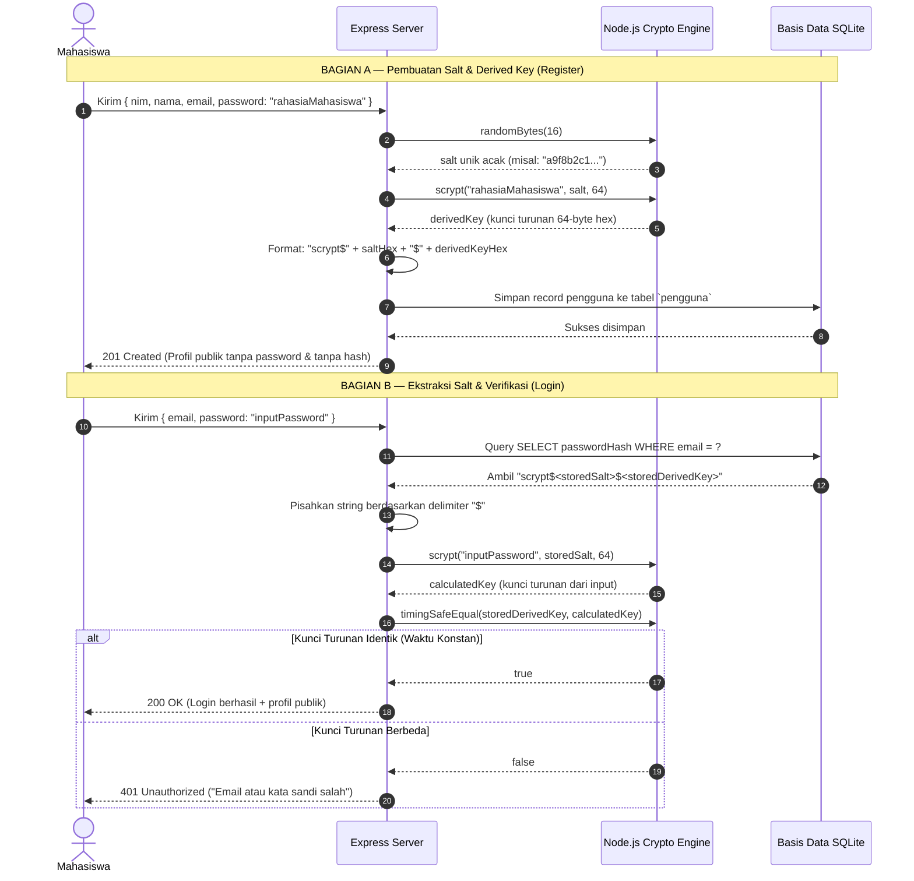

# Laporan Latihan Individu — Pertemuan 9
## Autentikasi, Password Hashing, dan Validasi Identitas Pengguna

* **Nama Mahasiswa:** Sandika Yusuf Permana
* **NIM:** 240160221044
* **Mata Kuliah:** Praktikum Backend Web Framework (SI-VA)
* **Pertemuan:** Pertemuan 9
* **Studi Kasus:** Sistem Informasi Akademik / Manajemen Data Mahasiswa

---

## 1. Subsoal 1: Penambahan NIM sebagai Identitas Unik Kedua dan Validasi Format

Dalam sistem informasi akademik, NIM (*Nomor Induk Mahasiswa*) merupakan pengidentifikasi primer di dunia nyata yang bersifat unik bagi setiap mahasiswa di samping alamat email resmi kampus.

### Implementasi Validasi
Validasi NIM diterapkan secara ketat dengan aturan:
- Tipe data harus string primitif (`typeof nim === "string"`).
- Panjang karakter antara 8 hingga 20 digit.
- Seluruh karakter harus berupa digit angka (`/^\d+$/`).

Kode implementasi pada `latihan-9.ts`:
```typescript
export const isValidNIM = (nim: unknown): { valid: boolean; message?: string } => {
  if (typeof nim !== "string") {
    return { valid: false, message: "NIM harus berupa teks (string)" };
  }
  const cleanNIM = nim.trim();
  if (cleanNIM.length < 8 || cleanNIM.length > 20) {
    return { valid: false, message: "Panjang NIM harus antara 8 hingga 20 digit" };
  }
  if (!/^\d+$/.test(cleanNIM)) {
    return { valid: false, message: "NIM hanya boleh terdiri dari digit angka (0-9)" };
  }
  return { valid: true };
};
```

Pada skema database Prisma, keunikan NIM dijamin dengan atribut `@unique`:
```prisma
model Pengguna {
  id           Int      @id @default(autoincrement())
  nim          String   @unique
  nama         String
  email        String   @unique
  passwordHash String
  role         String   @default("mahasiswa")
  createdAt    DateTime @default(now())
}
```

---

## 2. Subsoal 2: Pengujian Login Benar/Salah, Email Tidak Terdaftar, dan Tipe Field Keliru

Pengujian dilakukan secara otomatis menggunakan skrip [`test-latihan-9.ts`](./test-latihan-9.ts).

### Hasil Eksekusi Pengujian:

| No | Skenario Pengujian | Input yang Diuji | Status Diharapkan | Status Aktual | Hasil |
|:---:|---|---|:---:|:---:|:---:|
| 1 | Validasi NIM valid numerik | `"240160221044"` | Valid | Valid | **PASS** |
| 2 | Validasi NIM mengandung huruf | `"24016022ABC"` | Invalid | Invalid | **PASS** |
| 3 | Validasi NIM terlalu pendek | `"12345"` | Invalid | Invalid | **PASS** |
| 4 | Validasi NIM tipe angka primitif | `1234567890` | Invalid | Invalid | **PASS** |
| 5 | Login dengan kredensial benar | Email & password cocok | 200 OK | 200 OK | **PASS** |
| 6 | Login dengan password salah | Password keliru | 401 Unauthorized | 401 Unauthorized | **PASS** |
| 7 | Login dengan email tidak terdaftar | Email belum ada di DB | 401 Unauthorized | 401 Unauthorized | **PASS** |
| 8 | Login dengan tipe data keliru | Email bertipe `number` | 400 Bad Request | 400 Bad Request | **PASS** |
| 9 | Verifikasi kebersihan respons | Payload respons | Tanpa hash | Tanpa hash | **PASS** |

**Kesimpulan Pengujian:** 9 dari 9 pengujian lulus (100% PASS). Pesan kegagalan untuk kasus password salah dan email tidak terdaftar menghasilkan pesan seragam `"Email atau kata sandi salah"`.

---

## 3. Subsoal 3: Mengapa Hash Tidak Boleh Dikirim sebagai Pengganti Password pada Respons dan Mengapa Hash Bukan Kredensial?

Terdapat alasan keamanan mendasar mengapa nilai hash tidak boleh disertakan pada respons API maupun diperlakukan sebagai password:

1. **Prinsip Hak Akses Minimum (*Least Privilege*) dan Pencegahan Kebocoran**:
   Klien (browser atau aplikasi mobile) tidak memiliki kepentingan fungsional apa pun terhadap nilai hash. Mengirimkan hash ke klien hanya membuka celah kebocoran data sensitif (*information disclosure*).
2. **Serangan *Offline Cracking***:
   Meskipun algoritma `scrypt` dirancang lambat dan berat memori, jika penyerang berhasil mencegat nilai hash (melalui respons API yang tidak terenkripsi atau inspeksi browser), penyerang dapat mengeksekusi serangan *offline brute force* atau *dictionary attack* tanpa interaksi ke server dan tanpa terdeteksi oleh rate limiter server.
3. **Mencegah Serangan *Pass-the-Hash***:
   Jika backend menerima nilai hash sebagai pengganti password untuk otentikasi, maka nilai hash tersebut de facto berubah menjadi password teks biasa (*plaintext password*). Siapa pun yang mendapatkan hash tersebut dapat langsung login tanpa perlu mengetahui password aslinya.
4. **Hashing adalah Operasi Satu Arah**:
   Hash dirancang untuk verifikasi matematis internal di server. Identitas pengguna hanya boleh dibuktikan dengan pengetahuan rahasia asli yang dimasukkan langsung oleh pengguna saat login.

---

## 4. Subsoal 4: Sequence Diagram Pembuatan Salt dan Verifikasi Login

Berikut adalah visualisasi alur kriptografi pembuatan salt unik pada proses pendaftaran dan verifikasi kunci turunan saat login:



---

## 5. Cara Menjalankan Skrip Pengujian

Untuk memverifikasi implementasi latihan individu:
```bash
cd Sandikayusuf-240160221044/Pertemuan-9/Latihan-Individu
node --experimental-strip-types test-latihan-9.ts
```

