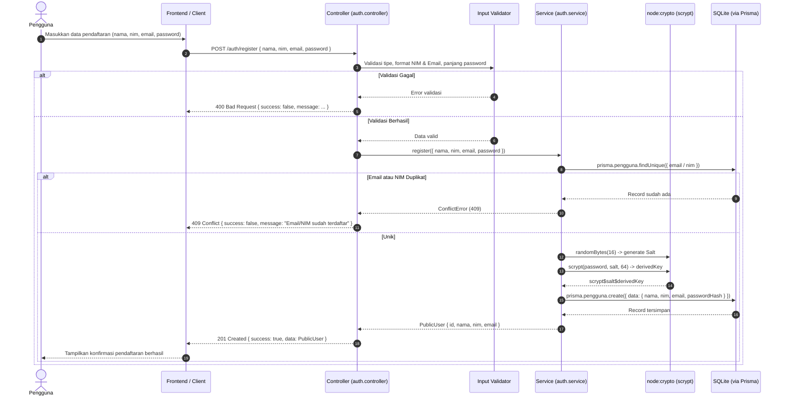
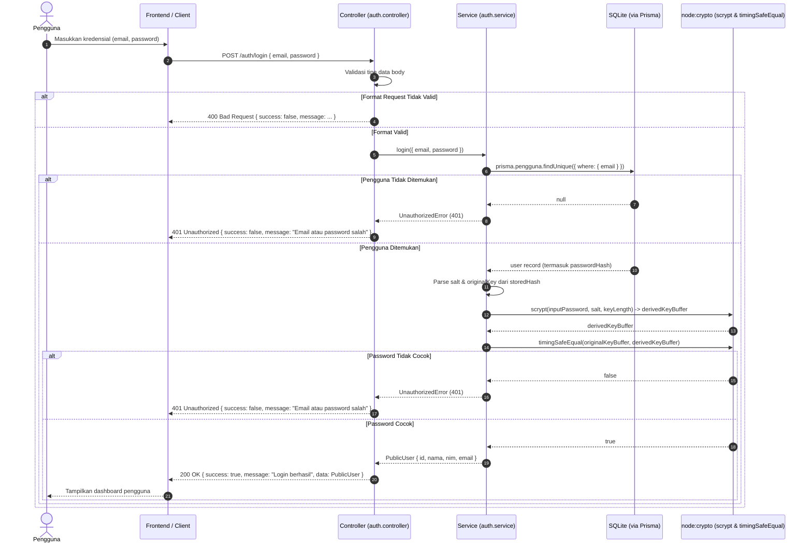

# Latihan Individu — Authentication & Password Hashing (Pertemuan 9)

**Mahasiswa:** Sarah Azkiya  
**NIM:** 240160221057  
**Mata Kuliah:** Pemrograman Berbasis Web Back End  
**Studi Kasus:** Sistem Informasi Perpustakaan  

---

## Poin 1 — NIM sebagai Identitas Unik Kedua

Pada sistem perpustakaan perguruan tinggi, Nomor Induk Mahasiswa (NIM) berfungsi sebagai nomor pokok anggota pemustaka. Pada latihan ini:
1. **Validasi Format NIM:**
   - NIM divalidasi harus berupa string numerik (hanya angka) dengan panjang antara 8 hingga 15 digit menggunakan ekspresi reguler `/^\d{8,15}$/`.
   - Input dengan karakter non-angka atau panjang di luar batas ditolak dengan status `400 Bad Request`.
2. **Pencegahan Duplikasi (Unique Constraint):**
   - NIM diproteksi secara ganda: pada lapisan aplikasi melalui pengecekan `prisma.pengguna.findUnique({ where: { nim } })` yang melempar `ConflictError` (HTTP 409), dan pada lapisan database SQLite melalui `CREATE UNIQUE INDEX "Pengguna_nim_key" ON "Pengguna"("nim")`.

---

## Poin 2 — Hasil Pengujian Autentikasi (12 Skenario)

Pengujian otomatis dijalankan melalui script `test-runner.ts` dengan 12 skenario pengujian utama:

| No | Skenario Pengujian | Status HTTP yang Diharapkan | Hasil Aktual | Keterangan |
|---|---|---|---|---|
| 1 | Register dengan data valid | `201 Created` | **PASS (201)** | Akun berhasil dibuat dan tersimpan di database |
| 2 | Register dengan data invalid (nama kosong, NIM < 8 digit, email invalid, password < 8 char) | `400 Bad Request` | **PASS (400)** | Ditolak oleh validator input sebelum mencapai service |
| 3 | Register dengan email duplikat | `409 Conflict` | **PASS (409)** | Database / Service melempar `ConflictError` |
| 4 | Register dengan NIM duplikat | `409 Conflict` | **PASS (409)** | Database / Service melempar `ConflictError` |
| 5 | Login dengan kredensial benar | `200 OK` | **PASS (200)** | Mengembalikan profil publik pengguna |
| 6 | Login dengan password salah | `401 Unauthorized` | **PASS (401)** | Ditolak dengan pesan `"Email atau password salah"` |
| 7 | Login dengan email tidak terdaftar | `401 Unauthorized` | **PASS (401)** | Ditolak dengan pesan generik yang sama (mencegah enumerasi akun) |
| 8 | Login dengan tipe field salah (bukan string) | `400 Bad Request` | **PASS (400)** | Ditolak pada tahap validasi controller |
| 9 | Response register bebas dari credential | Tidak ada field rahasia | **PASS** | `password` dan `passwordHash` tidak ada dalam response |
| 10 | Response login bebas dari credential | Tidak ada field rahasia | **PASS** | `password` dan `passwordHash` tidak ada dalam response |
| 11 | Integritas database: tidak ada plaintext | Non-plaintext | **PASS** | Database menyimpan hasil hash scrypt, bukan kata sandi asli |
| 12 | Format passwordHash terstandarisasi | `scrypt$salt$derivedKey` | **PASS** | 16-byte salt (32 hex) dan 64-byte key (128 hex) |

---

## Poin 3 — Penjelasan Kritis: Mengapa `passwordHash` Dilarang Ada pada Response

`passwordHash` **bukanlah** kata sandi alternatif dan sama sekali **tidak boleh** dikirimkan kepada client dalam bentuk apa pun karena alasan keamanan berikut:

1. **Prinsip Kebutuhan (*Need-to-Know Principle*):**
   - Client (frontend/browser) hanya membutuhkan bukti atau data profil pengguna (`id`, `nama`, `nim`, `email`). Client tidak memiliki peran dalam memverifikasi hash sehingga tidak memiliki kebutuhan fungsional terhadap `passwordHash`.
2. **Mencegah Serangan Komputasi Offline (*Offline Attack*):**
   - Jika penyerang mendapatkan `passwordHash` (misalnya melalui interception jaringan, inspeksi cache browser, atau kebocoran log), penyerang dapat menjalankan serangan *offline brute force* atau *dictionary attack* tanpa batasan laju request (*rate limiting*) dari server.
3. **Mencegah Risiko *Pass-the-Hash*:**
   - Dalam arsitektur sistem tertentu yang tidak terisolasi dengan baik, memiliki hash dapat disalahgunakan penyerang untuk mengotentikasi diri tanpa pernah mengetahui kata sandi aslinya.
4. **Kerahasiaan Bahan Kriptografi:**
   - Format hash `scrypt$<salt>$<derivedKey>` memuat salt dan hasil turunan kunci. Mempublikasikan materi kriptografi ini mempermudah analisis kriptanalisis terhadap sistem.

---

## Poin 4 — Sequence Diagram

### A. Sequence Diagram: Pendaftaran Pengguna (Register)



### B. Sequence Diagram: Autentikasi Pengguna (Login)



---

## Cara Menjalankan Pengujian

```bash
cd Sarah-Azkiya-240160221057/Pertemuan-9/latihan-individu
node --experimental-strip-types test-runner.ts
```
Hasil: **12/12 lolos (100% Pass)**.

