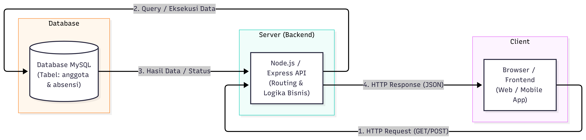

# LAPORAN TUGAS 1: ANALISIS & DESAIN API

* **Nama:** Winda Nurhidayah
* **NIM:** 240160221047
* **Kelas:** SI-VA
* **Domain Sistem:** Sistem Informasi Absensi Organisasi

## 1. Deskripsi Sistem
Sistem Informasi Absensi Organisasi adalah sistem yang digunakan untuk mengelola data anggota dan mencatat kehadiran anggota dalam kegiatan atau rapat organisasi. Sistem ini digunakan oleh pengurus dan anggota organisasi. Pengurus dapat mengelola data anggota dan mencatat absensi, sedangkan anggota dapat melihat data kehadirannya.

## 2. Diagram Arsitektur (Client–Server)

Berikut adalah diagram alur komunikasi permintaan (*request*) dan balasan (*response*) antara *Client*, *Server Backend*, dan *Database*:



## 3. Tabel Resource & Endpoint

Dua resource utama yang dikelola dalam sistem ini adalah **`anggota`** dan **`absensi`** (dengan total 8 endpoint RESTful):

| No | Operasi | Method | Endpoint | Request Body | Response Body (Sukses) | Status Sukses | Status Gagal |
|:--|:---|:---|:---|:---|:---|:---:|:---:|
| 1 | Daftar semua anggota | `GET` | `/anggota` | — | `{ success, data: [...] }` | `200` | `500` |
| 2 | Detail satu anggota | `GET` | `/anggota/:id` | — | `{ success, data: {...} }` | `200` | `404` |
| 3 | Tambah anggota baru | `POST` | `/anggota` | `{nim, nama, jabatan}` | `{ success, message, data }` | `201` | `400` |
| 4 | Update data anggota utuh | `PUT` | `/anggota/:id` | `{nim, nama, jabatan}` | `{ success, message, data }` | `200` | `404` |
| 5 | Ubah sebagian data anggota | `PATCH` | `/anggota/:id` | `{jabatan}` | `{ success, message, data }` | `200` | `404` |
| 6 | Hapus anggota | `DELETE` | `/anggota/:id` | — | `{ success, message }` | `204` | `404` |
| 7 | Catat kehadiran / Absen | `POST` | `/absensi` | `{nim, id_kegiatan, status}` | `{ success, message, data }` | `201` | `400` |
| 8 | Lihat riwayat absensi anggota | `GET` | `/anggota/:id/absensi` | — | `{ success, data: [...] }` | `200` | `404` |

# 4. Contoh JSON (Request & Response Body)

* **Resource: `anggota` (POST `/anggota`)**
  * *Request Body:*
    ```json
    {
      "nim": "F1D022099",
      "nama": "Budi Pratama",
      "jabatan": "Anggota Divisi Pemrograman"
    }
    ```
  * *Response Body (201 Created):*
    ```json
    {
      "success": true,
      "message": "Data anggota berhasil ditambahkan",
      "data": {
        "id": 1,
        "nim": "F1D022099",
        "nama": "Budi Pratama",
        "jabatan": "Anggota Divisi Pemrograman"
      }
    }
    ```

* **Resource: `absensi` (POST `/absensi`)**
  * *Request Body:*
    ```json
    {
      "nim": "F1D022099",
      "id_kegiatan": 3,
      "status": "hadir"
    }
    ```
  * *Response Body (201 Created):*
    ```json
    {
      "success": true,
      "message": "Kehadiran berhasil dicatat",
      "data": {
        "id_absensi": 105,
        "nim": "F1D022099",
        "id_kegiatan": 3,
        "status": "hadir",
        "waktu": "2026-09-27T16:30:00Z"
      }
    }
    ```

---

## 5. Skenario Uji

1. **Skenario Sukses 1 (Mengambil Daftar Anggota):**
   * *Request:* `GET /anggota`
   * *Proses:* Server menerima permintaan dari client dan mengambil seluruh data anggota dari database.
   * *Response:* Status **`200 OK`** mengembalikan data array daftar seluruh anggota organisasi.

2. **Skenario Sukses 2 (Mencatat Kehadiran / Absen):**
   * *Request:* `POST /absensi` dengan body `{ "nim": "F1D022099", "id_kegiatan": 3, "status": "hadir" }`
   * *Proses:* Server memvalidasi data dan mencatat kehadiran anggota ke tabel database.
   * *Response:* Status **`201 Created`** mengembalikan pesan sukses beserta detail data absensi.

3. **Skenario Gagal (Data Anggota Tidak Ditemukan / 404):**
   * *Request:* `GET /anggota/999/absensi`
   * *Proses:* Server mencari riwayat absensi untuk ID `999`, tetapi data anggota tersebut tidak terdaftar.
   * *Response:* Status **`404 Not Found`**
     ```json
     {
       "success": false,
       "message": "Anggota dengan ID tersebut tidak ditemukan"
     }
     ```
